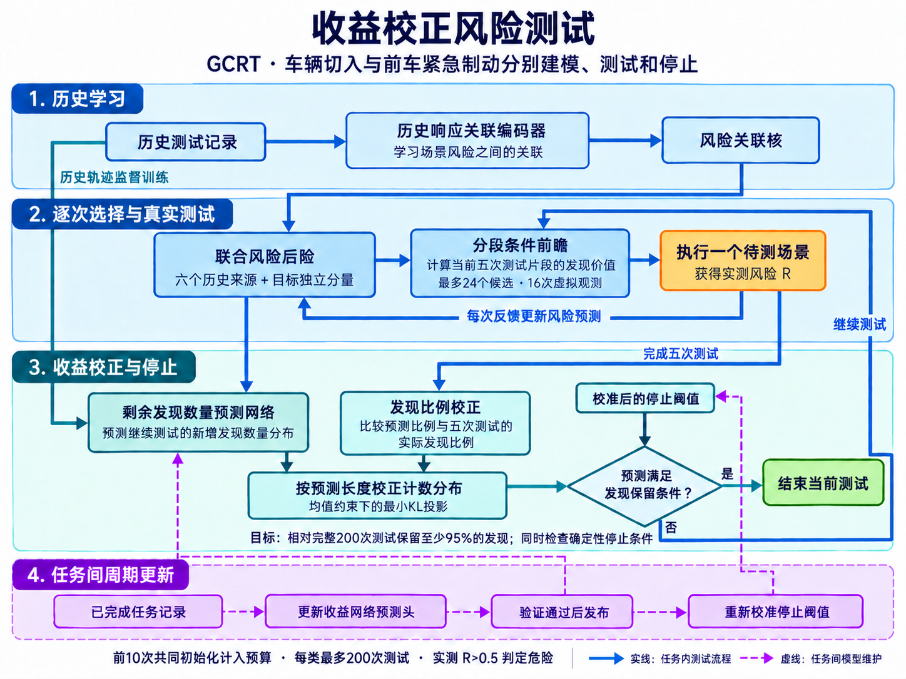

# 收益校正风险测试

收益校正风险测试（GCRT，Gain-Calibrated Risk Testing）利用已有测试记录，优先选择可能危险的自动驾驶场景，并根据当前测试反馈判断何时停止。

车辆切入、跟驰过程中的前车紧急制动分别训练模型、选择场景和决定测试次数。方法流程为：

**历史风险预测 → 逐次选择场景 → 真实测试与风险更新 → 校正剩余发现预测 → 继续或停止。**

历史响应关联编码器学习场景之间的风险联系；剩余发现数量预测网络估计继续测试还能找到多少危险场景。每完成五次测试，用实际发现比例校正预测；任务之间可用新增记录更新预测网络。



## 运行

在项目根目录、现有 `metadrive` 环境中执行：

```powershell
conda activate metadrive
python -B -m methods.gcrt.build
python -B -m methods.gcrt.evaluation
```

`build` 从历史记录构建模型，已有组件直接复用；`evaluation` 复用或补齐完整测试轨迹，完成停止评价、一次网络更新和成本分析。当前实验使用已有实测响应回放。

只重新汇总结果时运行：

```powershell
python -B -m methods.gcrt.report
```

补充实验的运行顺序和缓存要求见 [GCRT 运行说明](methods/gcrt/README.md)。

## 实验设置与结果

- 功能场景：车辆切入、前车紧急制动。
- 三个场景测试集：参数范围相同、Sobol 采样点不同；每个测试集每类 1024 个场景。
- 被测驾驶控制器：IDM、FVDM、IDM＋MOBIL、碰撞时间值迭代、恒速预测蒙特卡洛树搜索（MCTS）、PPO。
- 历史来源：六种 IDM／FVDM 配置。固定随机种子 11，每类最多测试 200 次，包含前 10 次共同初始化。
- 危险判定：实测风险 `R > 0.5`；碰撞另按实测 `collision` 标签统计。

已完成 36 条完整测试轨迹、提前停止评价和一次周期更新，共回放 7200 次场景查询，无新增物理仿真。

| 结果入口 | 评价范围与内容 |
|---|---|
| [完整实验报告](results/gcrt/comparison.md) | 六种控制器的发现能力；预设 IDM、IDM＋MOBIL 的 12 组停止评价；包含构建和维护的复用成本 |
| [发现效果与测试效率](results/gcrt/retention_efficiency/README.md) | 车辆切入的 IDM、IDM＋MOBIL 与紧急制动的 MCTS，共 9 组配置；比较 GCRT 与均匀随机测试 |
| [发现数分布校正](results/gcrt/calibration_effectiveness/README.md) | 相同 9 组配置的 342 个共同检查点；比较校正前后的预测误差与停止结果 |

一组配置指一个控制器在一个功能场景、一个测试集上的实验。MCTS 紧急制动为查看原结果后增加的探索性补充评价，停止参数使用其他控制器的记录重新校准；原预设结果单独保留。各报告分别说明评价范围和成本口径。

## 文件在哪里

| 位置 | 用途 |
|---|---|
| [methods/gcrt](methods/gcrt/README.md) | 本发明方法 |
| [methods/baselines](methods/baselines/README.md) | LRT、CG-BRT、DART、HGT 等对比方法 |
| [methods/common](methods/common/README.md) | 历史先验、候选特征与概率工具 |
| [benchmark](benchmark/README.md) | 实验设置、数据读取、风险反馈与计时 |
| [simulation](simulation/README.md)、[controllers](controllers/README.md) | 仿真环境与驾驶控制器 |
| [data](data/README.md) | 历史记录、场景参数与实测响应 |
| [results](results/README.md) | 权重、训练记录、查询轨迹与报告 |
| [tests](tests/) | 方法与共享组件的回归测试 |
| [docs/style.md](docs/style.md) | 编码与文档规范 |

## 论文与交流规范

- 使用简明中文和常用术语，直接说明问题、方法和结果，避免临时造词、重复说明和防御性表述。方法标题使用中文，首次出现时定义英文全称与缩写；对比方法使用真实名称。
- 明确功能场景、驾驶控制器、历史来源和场景测试集。结果优先说明发现数量、覆盖率、实际仿真调用次数和耗时；图表要求见[测试效率实验说明](results/gcrt/retention_efficiency/README.md)。
- “收益”指新增危险用例数；“场景选择规则”决定下一次测试的场景；“剩余发现数量预测”用于停止判断；“停止校准”用于确定阈值。五次连续测试统一称为“测试片段”。
- 区分风险后验更新、任务内收益校正和网络训练。每轮执行一个场景；网络更新使用已完成的测试记录，并在后续实验中评价。
- 分别报告危险与碰撞结果。覆盖率以对应测试集的全部同类用例为分母；发现数保留比例以同一查询顺序下完整预算的发现数为分母。等权平均与合并计数分别标注，分母为零时记为未定义。
- 区分当前实现、已完成实验和拟议改进，完整保留预设结果。说明技术在自动驾驶测试中的作用和收益，补充实验围绕尚未回答的问题安排。
