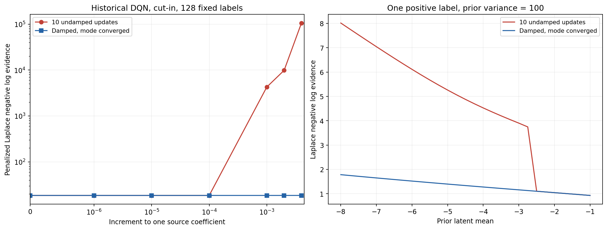

# ScaML-GP碰撞分类开发准备

本项补齐[方法定位](collision_discovery_method_positioning.md)中的多来源先验基线。ScaML-GP将来源后验合并成单个目标GP，来源系数和目标残差核由目标响应确定；该已有结构与本项目的来源概率混合直接相关。分类核心、历史检查及独立入口现已完成，160项设计已登记并排队，尚未启动开发查询；当前240项、RGPE已登记80项及既有失败结论保持不变。

## 固定分类设置

采用同一8个历史系统的碰撞后验及相同历史辅助训练信息，目标使用同一FSBO基础表示。查询后从基础模型重置，仅用已付费碰撞适配10步Adam、学习率0.003；固定该表示及目标均值，再优化ScaML来源系数、Matérn 5/2残差核的长度尺度与信号方差。具体中心化、Gamma(1,1)来源系数先验、正系数和核边界见[实现定义](../methods/baselines/scaml_gp/README.md)。它们在读取新开发结果前确定，不把高斯回归、输出标准化或连续空间收购函数原样用于二元碰撞。

无来源系数归一化；潜在协方差使用平方系数。标量优化每次从`1/H`和当次FSBO核参数重新初始化，L-BFGS-B最多100步、500次评估，`ftol=1e-9、gtol=1e-5、maxls=30`。源后验始终只来自各自允许的历史档案，不按目标标签重新训练历史来源。所有目标监督均为已付费碰撞Boolean，不向选择器暴露全库标签、召回分母或未查询轨迹。

新基线的分类模式采用白化坐标和阻尼Newton，最多100步，模式梯度要求`1e-10`。目标值、梯度及预测使用同一个收敛模式；原先10步无阻尼模式在新的标量搜索范围中出现振荡，因此不能仅用“优化器成功”验收。原失败已保存，旧冻结分类器不改。来源机制和数值模式的变化分别说明，不把更换数值推断本身当作新迁移机制。

提供有无0.10物理概率分量的两个来源模式，并各配一个无显式来源后验的目标控制。四者共用相同FSBO表示适配、收敛模式、核参数边界及标量优化；目标控制不接收来源均值、协方差或参考均值，只有两个残差核参数，没有来源系数及其先验。物理分量沿用原10步、学习率0.01的目标GP，只用已付费碰撞。这样区分加入来源后验与改变推断/核优化带来的差异，不将跨求解器比较单独归因于来源经验。

## 历史准备与进入条件

历史检查覆盖8个伪目标×两个场景×8/128支持点，共32组。支持位置来自种子1301的固定512点排列，伪目标自身来源实际排除；单类标签任务照常保留。基础教师包含所有历史对象，故这里只核查构建和数值实现，不作为独立留系统泛化结果。

每项独立重建完整512点的先验均值、协方差及碰撞概率，并检查收敛模式下的边际证据和标量参数梯度。独立路径采用NumPy/SciPy矩阵运算及Powell混合求根，主实现采用PyTorch阻尼Newton；共享历史输入及确定的标量参数，GP推断独立。有限差分使用四阶差分，在参数边界内计算。保存每次优化的停止原因、模式梯度、投影梯度、迭代次数和目标变化；达到迭代上限不记作已收敛。模式失败、非有限量、目标升高或独立核对不符时停止准备，先诊断，暂不登记开发实验。

```powershell
python -B -m pytest tests/baselines/test_scaml_search.py -q
python -B -m benchmark.discovery_scaml_audit
```

准备产物位于`results/baselines/scaml_gp/collision/preparation/`。初次无阻尼失败的历史DQN切入128点支持及参数扰动保存在`undamped_failure.json`和`undamped_failure_inputs.npz`；没有新增开发查询或物理调用。13项专门检查及81项相关合并回归通过，32组阻尼模式核查现已全部完成。

完整历史核查耗时59.61秒，最大完整库概率差4.97e-12、目标值差8.34e-11、梯度差4.09e-8。32次标量优化均正常停止，其中31次达到投影梯度条件，1次依据相对目标变化停止；最大投影梯度8.60e-5，不声称超参数取得全局最优。预测模式的最大白化梯度6.52e-11，全部优化内部模式满足1e-10阈值。

数值修正另保存固定失败参数的扰动对照及一维解析模式核对：历史来源系数增加0.001时，旧10步模式目标从约18.540跳至4260.454，收敛模式则从18.539平滑变为18.541；同一输入下PyTorch与独立NumPy/SciPy一致。单点先验均值−5、方差100、正标签时，旧近似负对数证据为5.261565，收敛Laplace为1.396510，与解析模式方程一致。这解释了原准备失败的数值原因，不表示发现收益。

```powershell
python -B -m benchmark.discovery_scaml_audit correction
```



对应JSON、PNG/SVG/PDF同名保存，PNG已目视检查。旧冻结方法、当前240项及RGPE设计均保持原样；这一新的收敛求解器只用于新基线准备。

## 后续开发比较

无来源目标控制补做了相同32组完整库概率、目标值与梯度检查，不读取来源后验；全部正常停止，最大概率差4.97e-12、梯度差1.32e-8，耗时34.52秒。四模式17项专门检查，加上实验预算、角色、参考完整性与旧相关组件，共98项合并回归通过。原有32项来源数值证据与失败修正记录保留。

矩阵固定为：

| 方法 | 显式来源后验 | 收敛模式和核优化 | 物理概率质量 | 运行数 |
|---|---|---|---:|---:|
| `scaml_classifier` | 8个历史来源 | 相同 | 0 | 40 |
| `physical_scaml_classifier` | 8个历史来源 | 相同 | 0.10 | 40 |
| `scaml_target` | 无 | 相同 | 0 | 40 |
| `physical_scaml_target` | 无 | 相同 | 0.10 | 40 |

仍使用4个现有开发系统、切入/切出、每项512候选、128查询含8次共同初始化，以及五个配对种子11/23/37/53/71、环境81001。共160项、20,480次等效查询，复用旧完整档案，新增物理调用为零。四项实际首轮属于160项，不另行扩大样本。

`prepare`已先登记全部配置、30个既有参考、源码及准备证据；当前240项和RGPE的80项分别完成完整审计与报告后，才由`freeze`核对参考和设计一致性。原32项及新32项准备证据在登记后不重新写入。已启动依赖队列，核实前序进程退出后还须检查完整结果、审计、损坏控制和报告，任一步非零退出即停止；不是仅凭状态文件或父进程退出启动查询。

```powershell
python -B -m benchmark.discovery_scaml prepare
python -B -m benchmark.discovery_scaml freeze
python -B -m benchmark.discovery_scaml smoke
python -B -m benchmark.discovery_scaml_audit smoke
python -B -m benchmark.discovery_scaml_audit negative
python -B -m benchmark.discovery_scaml run
python -B -m benchmark.discovery_scaml_audit complete
python -B -m benchmark.discovery_scaml report
```

首轮四种方法分别执行同一固定开发任务，各128次查询；四项实际反馈、完整分母和12次完整候选选点重建通过，至少八种内存损坏被拒绝后，才允许完整运行。损坏控制覆盖标签、分母、重复、物理质量、系数、模式梯度、优化目标、内部自洽错误概率、成本及目标控制接收来源信息。原文件和付费账本不改。

逐项审计核对128条原始反馈、完整库去重分母、初始化计费、曲线/预算点及每步参数、概率、优化停止与模式梯度摘要。在查询9/65/128之前重新拟合目标表示及标量参数，再用独立NumPy/SciPy重建512点概率和实际选点；初始先验另作标量数值核对。完整160项和480次完整候选选点通过后才生成报告，不把摘要检查称为每步独立重算全部优化。

运行位于`results/baselines/scaml_gp/collision/discovery/runs/`；登记、冻结、审计、失败账本、JSON/Markdown报告及PNG/SVG/PDF曲线位于`results/benchmark/collision/discovery/scaml/`；准备证据保留原目录。逐项审计缓存绑定审计依赖、协议、原运行与原始反馈，变动后重算。

强参考需包含此前全部完成方法，不能因RGPE或其他辅助方法更强而将其删除。按原口径报告数量、召回、预算点、完整曲线、配对分层区间与计算成本。先做实际首项、原始反馈/分母/预算/选点独立检查和损坏控制，再运行完整矩阵。发现过程、历史构建、来源构建、标量优化、表示适配、回放及失败尝试分别计费。

这是一组外部基线比较，不指定新的本文主方法，也不自动通过阶段B或启动C/D/E。新交互任务、八个独立目标、最终一致性重训及严格留家族仍按[原执行方案](collision_discovery_plan.md)的进入条件实施。

## 冻结与实际首轮验收

RGPE80项及其完整审计、报告现已全部完成。依赖流水线核对30种前序参考和未变登记设计后，冻结本组协议并完成四项实际首轮，共512次等效查询。12次独立全候选选点重建、全部反馈/分母/预算核对和10项损坏控制通过，记录在`scaml/audit/smoke.json`及`negative_controls.json`。

随后启动160项完整矩阵，四项首轮复用计入总数；当时要求160项和480次独立完整候选重建全部通过后才输出比较及图表，收敛来源主方法继续等待本组验收。实时完成数和进程身份见`execution_status.json`，失败时保留账本和成本。完整验收结果见本节末尾。

运行期间另完成当时22项完整记录的增量审计，2,816条反馈/逐步摘要及66次独立全候选重建通过。复用4份首轮审计，新增18份逐项记录，后续完整审计可按相同身份校验复用。该批到审计结果落盘经过62.59秒，新增工作进程核对耗时合计100.39秒；与在途选择器共享GPU，不作为独占算法计时。结果在`scaml/audit/available.json`，重叠区间在`scaml/orchestration/available_audit.json`；`whole_matrix_audited=false`，不表示160项整组通过，也未增加查询或物理执行。

随后将增量审计扩展到43项，包含来源分类模式全部40个配对任务及另外三模式的首项。5,504条反馈/逐步摘要和129次独立完整候选重建通过，新增21份逐项记录并复用原22份。扩展批到结果落盘经过76.22秒，新增工作进程核对合计119.46秒，仍按共享GPU区间计费。原22项完整审计及成本已归档至`scaml/orchestration/available_audit_history.jsonl`，`available.json`指向最新43项范围。整组比较继续，尚不报告四模式的完整收益。

两种来源模式各40项完成后，再将增量审计扩展到83项。10,624条反馈/逐步摘要和249次独立全候选重建通过，包含两种来源模式的全部80项；新增40份逐项审计，复用原43份。该批到结果落盘经过161.03秒，新增工作进程核对合计286.42秒，均为共享GPU计时。原22项和43项完整审计及成本按顺序保留在上述历史文件中，`available.json`现指向83项范围。两个无显式来源后验控制仍在运行，整组160项尚未完成，不据已完成模式更换主方法或比较对象。

无物理混合的目标控制40项完成后，第四批增量审计覆盖125项，包括三种模式各40项及物理目标控制5项。16,000条反馈/逐步摘要和375次独立全候选重建通过；新增42份逐项记录，复用83份。该批共享GPU经过125.86秒，新增工作进程核对合计216.04秒。原83项完整审计及成本已追加到同一历史文件，`available.json`更新为125项范围；仍不表示160项整组验收通过，不新增查询或物理执行。

## 完整验收与结果

160项运行、20,480条反馈/逐步摘要及480次独立完整候选重建现已全部通过，10项损坏控制继续有效。最终审计新增35份逐项记录并复用125份，进程创建至结果落盘96.22秒，新增工作进程核对合计162.54秒；全部160份唯一逐项审计的工作进程耗时合计902.33秒。增量审计的共享GPU区间仍单列，不作为独占算法计时。没有失败运行或新增物理调用。

| 方法 | 平均去重碰撞数 | 平均召回率 | 发现曲线AUC |
|---|---:|---:|---:|
| `scaml_classifier` | 36.000 | 90.5785% | 22.227734 |
| `physical_scaml_classifier` | 36.625 | 94.4997% | 21.964258 |
| `scaml_target` | 34.475 | 88.3990% | 21.393164 |
| `physical_scaml_target` | 35.900 | 93.7603% | 21.392578 |

来源版本相对对应无显式来源后验控制的平均召回差分别为2.1794和0.7393个百分点，两项配对分层95%区间均跨零。四种方法均低于既有最强参考`physical_local`的37.875个、98.5857%召回，不据此认定来源迁移获得稳定发现收益。全部34种方法、1,360条配对记录的谱系汇总、128点曲线及16/32/64/128预算点另经独立重算，最大数值差1.43e-14；零碰撞任务保留，PNG已目视检查。

完整[报告与成本](../results/benchmark/collision/discovery/scaml/report.md)及`report_checks.json`保留上述结果。最强参考未改变，50%漏检减少仍要求至少99.2929%召回，IDM/MOBIL与PPO两个谱系存在理论提升空间；更新证据为`feasibility/after_scaml.json`。已登记的收敛来源160项在本组验收后冻结并开始四项实际首轮。本组作为外部比较完成，不更换主方法，不改变旧失败结论，C/D/E仍未进入。
