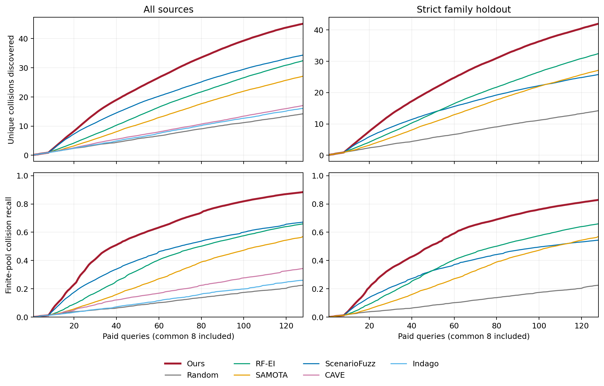
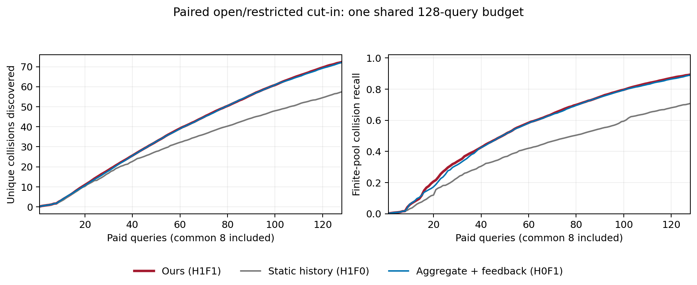

# 独立驾驶系统的有限预算碰撞发现

8个独立对象、5类场景、5个配对种子；全来源主比较1,400项、严格留家族新增400项、新交互任务两个控制80项。全部1,880项、240,640次等效查询及600项复用引用通过审计。

严格留家族中的Random、RF-EI和SAMOTA引用相同任务的全来源记录，不重复查询或计入执行成本；Indago及配对系统方法保留在完整主比较中。

## all_sources

| 方法 | 去重碰撞数 | 有限库召回 | 发现AUC |
|---|---:|---:|---:|
| gcrt | 45.100000 | 0.883995 | 26.113945 |
| random | 14.215000 | 0.225272 | 7.231875 |
| av_bo_rf_ei | 32.425000 | 0.659508 | 16.853047 |
| samota | 27.115000 | 0.569757 | 13.692578 |
| scenario_fuzz | 34.350000 | 0.671816 | 19.856992 |
| paired_system_active_evaluation | 17.035000 | 0.343562 | 8.615781 |
| indago | 16.040000 | 0.260470 | 8.097969 |

本条件最强参考为scenario_fuzz；完整配对区间和谱系统计见JSON。

## strict_leave_family

| 方法 | 去重碰撞数 | 有限库召回 | 发现AUC |
|---|---:|---:|---:|
| gcrt | 41.955000 | 0.828786 | 24.105820 |
| scenario_fuzz | 25.755000 | 0.544219 | 15.173789 |
| random | 14.215000 | 0.225272 | 7.231875 |
| av_bo_rf_ei | 32.425000 | 0.659508 | 16.853047 |
| samota | 27.115000 | 0.569757 | 13.692578 |

本条件最强参考为av_bo_rf_ei；完整配对区间和谱系统计见JSON。

## 新交互任务的历史与反馈对照

主方法与静态历史排序H1F0、同信息聚合教师反馈H0F1比较，主方法记录复用主比较。保留各项差异及区间，不将三单元比较解释为完整H×F交互量。

| 单元 | 去重碰撞数 | 有限库召回 | 发现AUC |
|---|---:|---:|---:|
| gcrt | 72.300000 | 0.893281 | 39.283203 |
| H1F0 | 57.425000 | 0.707793 | 31.849609 |
| H0F1 | 72.100000 | 0.889855 | 39.126953 |
## 场景机制与成本

开放/受限切入条件各256个、共用128次预算；配对条件变化、预算分配和碰撞对象单独报告。

来源建设、模型训练、在线选例与保留仿真成本分项列在report.json，不把选例种子作为独立系统。

## 结果解读

全来源条件下，本文相对最强基线ScenarioFuzz平均多发现10.750组碰撞，增加31.30%；召回提高21.22个百分点，配对95%区间为14.91至28.69个百分点；发现AUC增加31.51%。8条实现/训练谱系的召回差异均为正。64次查询时本文平均召回65.39%，接近ScenarioFuzz在128次时的67.18%，体现了预算中段的发现效率。200项任务均保留，其中40项全库没有碰撞，召回统计使用其余160项。

严格留家族条件下，本文召回82.88%，相对本条件最强参照RF-EI的65.95%提高16.93个百分点，配对区间为7.21至26.42个百分点；平均碰撞数增加29.39%，AUC增加43.04%。相对预先确定的迁移基线ScenarioFuzz，召回提高28.46个百分点，区间为22.67至34.59个百分点。排除同家族来源后，本文召回相对全来源变化为−5.52个百分点，ScenarioFuzz为−12.76个百分点。这些比较支撑有限预算下的跨实例测试及排除同家族数据后的迁移价值。

交互任务中的反馈收益较清楚：联合方法相对静态历史排序平均增加14.875组碰撞，召回提高18.55个百分点，区间为7.50至33.34个百分点。与同信息聚合教师加反馈相比，平均增加0.200组、召回增加0.34个百分点，后者区间为−0.41至1.17个百分点。逐来源处理作为增量贡献方向解释；主要论证围绕整套历史响应复用与反馈适配流程，不追加组件实验。

## 配对交通条件与预算分配

8个对象各256组参数，共2,048组开放/受限配对：两条件均安全1,532组、仅受限碰撞284组、仅开放碰撞23组、两者均碰撞209组。完整库的开放条件共有232次碰撞，受限条件493次；受限碰撞中459次涉及切入车、29次涉及前方背景车、5次涉及后方背景车。

这种变化随驾驶系统而异。UCT和Beam由开放条件0次碰撞变为受限条件5次、30次；PPO由2次变为72次，DQN由45次变为190次；线性MPC为34次到33次，非线性规划为41次到41次。联合方法平均将83.275次查询分配给受限条件，但按目标反馈调整：DQN为124.2次、PPO为113.2次，而静态历史排序对所有对象均为79.6次。碰撞对象、事件后制动观测及换道查询数的全部记录保留在`report.json`的`interaction_task.paid_allocations`中。

## 分项计算成本

下表为全来源条件下每项128次查询的谱系等权平均秒数，采用16个CPU工作进程、选择器各1个原生线程。回放墙钟包含构造、进程通信等开销；选例与适配分别按原账本计时。原始仿真执行耗时另行保留，不混作本次回放延迟。

| 方法 | 回放墙钟/s | 选例/s | 在线适配/s |
|---|---:|---:|---:|
| 本文 | 71.814 | 12.927 | 42.499 |
| ScenarioFuzz | 18.802 | 0.656 | 0 |
| RF-EI | 286.439 | 13.491 | 256.247 |
| SAMOTA | 522.088 | 9.777 | 495.446 |
| 配对系统主动评估 | 80.721 | 8.416 | 55.248 |
| Indago | 43.798 | 26.955 | 0 |
| Random | 16.207 | 0.003 | 0 |

本文以比固定图模型更高的在线计算，换取同查询预算下更多、更早的碰撞发现；在线计算低于本任务中的RF-EI和SAMOTA。历史/开发共30,720次执行，其中新交互6,144次；独立目标库20,480次执行的建设成本单列。25个基础核经数值核对复用，新增训练为0；25个等权编码器构建计时之和137,696.244秒，已包含10,210.271秒前缀缓存。ScenarioFuzz复用8个范围、新训练17个，新增训练计时之和229,371.996秒；Indago复用4个、新训练1个，新增3.870秒。这些是记录并发下的组件计时之和，不是整个流程的实际等待时长。

## 核查与执行恢复

完整审计见[`audit.json`](audit.json)：1,880项运行、240,640次付费查询、600条来源明确的复用引用及1,440次独立选点重算全部通过。独立标签在协议冻结后读取，未用于模型选择；旧开发门槛和结果未改写。实际发现图及交互图的PNG均已目视检查，SVG和PDF同步导出。

Windows文件占用曾使原子替换进度索引失败，原工作流与首次缓存重放错误均保留。随后直接按冻结任务、保存路径和原始指标一次性恢复索引，并生成原定义的600条引用，再运行原审计与报告入口。恢复前后1,880份运行文件校验值完全一致，新增选择器查询和物理调用均为0；方法、模型、指标及统计配置未修改。依据见[`index_recovery.json`](index_recovery.json)。

三组必要证据已齐备，后续转入论文组织；不追加基线、初始化对照或组件网格。
