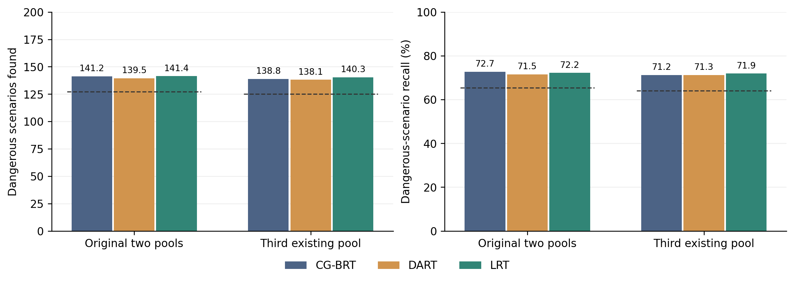
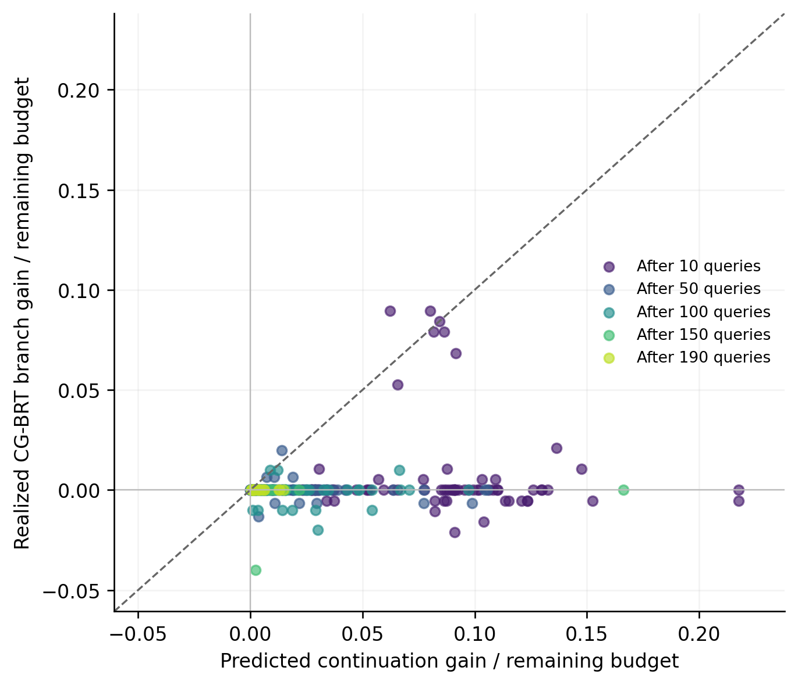

# 局部风险迁移方法的实验比较

主评价仅包含 H200 与危险场景 Recall。所有目标池均为已有池。
正式效果门槛分别适用于原有两池合并结果及第三池结果；档案失配条件用于机制诊断。
主实验效果门槛通过：True；完整方法平均每条主轨迹偏离 95.87 次。

虚线表示同池 CG-BRT 均值的 90%，不是置信区间。配对区间见下表后的统计结果。

## original_pools

| 方法 | H200 | Recall % | 替换数 | 实际同历史损失 | 预测损失 |
|---|---:|---:|---:|---:|---:|
| CG-BRT | 141.250 | 72.695 | 0.00 | 0.00 | 0.000 |
| DART | 139.533 | 71.480 | 74.62 | 20.63 | 15.999 |
| LRT | 141.417 | 72.197 | 95.25 | 19.18 | 14.167 |
| LRT：全局来源状态 | 141.883 | 72.413 | 97.17 | 19.33 | 14.019 |
| LRT：无档案协方差 | 141.367 | 72.073 | 105.35 | 19.70 | 14.232 |
| LRT：无目标独立分量 | 139.367 | 71.588 | 76.47 | 20.25 | 16.623 |
| LRT：一步前瞻 | 140.733 | 71.823 | 73.22 | 19.88 | 14.799 |
| LRT：单模型损失约束 | 141.317 | 72.134 | 99.63 | 20.37 | 14.096 |
| LRT：无损失预算 | 140.433 | 71.538 | 151.65 | 40.53 | 33.045 |

效果门槛通过：True。

| 系统 | CG-BRT H200 / Recall % | DART H200 / Recall % | LRT H200 / Recall % |
|---|---:|---:|---:|
| idm_ref | 191.20 / 20.95 | 199.40 / 21.85 | 198.70 / 21.78 |
| fvdm_target | 133.90 / 94.28 | 127.20 / 89.57 | 131.50 / 92.58 |
| mobil_ref_v2 | 92.50 / 100.00 | 92.50 / 100.00 | 92.50 / 100.00 |
| vi_ttc_ref_audit_v4 | 189.20 / 47.36 | 179.10 / 44.83 | 188.60 / 47.21 |
| mcts_cv_ref_audit_v4 | 131.70 / 73.58 | 130.00 / 72.63 | 128.20 / 71.61 |
| ppo_ref_v2 | 109.00 / 100.00 | 109.00 / 100.00 | 109.00 / 100.00 |

H200 保留比例 1.0012；Recall 保留比例 0.9932。
按系统成块重采样的配对差值 95% 区间：H200 [-2.183333333333337, 3.25]，Recall 百分点 [-1.2896125300767451, 0.24976704581967843]。

## third_existing_pool

| 方法 | H200 | Recall % | 替换数 | 实际同历史损失 | 预测损失 |
|---|---:|---:|---:|---:|---:|
| CG-BRT | 138.833 | 71.200 | 0.00 | 0.00 | 0.000 |
| DART | 138.067 | 71.262 | 70.37 | 20.67 | 15.664 |
| LRT | 140.333 | 71.899 | 97.10 | 19.73 | 13.912 |

效果门槛通过：True。

| 系统 | CG-BRT H200 / Recall % | DART H200 / Recall % | LRT H200 / Recall % |
|---|---:|---:|---:|
| idm_ref | 197.40 / 21.39 | 200.00 / 21.67 | 200.00 / 21.67 |
| fvdm_target | 122.00 / 87.77 | 127.40 / 91.65 | 126.80 / 91.22 |
| mobil_ref_v2 | 88.00 / 100.00 | 88.00 / 100.00 | 88.00 / 100.00 |
| vi_ttc_ref_audit_v4 | 189.60 / 47.16 | 179.20 / 44.58 | 191.00 / 47.51 |
| mcts_cv_ref_audit_v4 | 129.00 / 70.88 | 126.80 / 69.67 | 129.20 / 70.99 |
| ppo_ref_v2 | 107.00 / 100.00 | 107.00 / 100.00 | 107.00 / 100.00 |

H200 保留比例 1.0108；Recall 保留比例 1.0098。
按系统成块重采样的配对差值 95% 区间：H200 [0.2666666666666657, 2.9333333333333322]，Recall 百分点 [0.06526337512253082, 1.8212918594106249]。

## sparse

| 方法 | H200 | Recall % | 替换数 | 实际同历史损失 | 预测损失 |
|---|---:|---:|---:|---:|---:|
| CG-BRT | 142.500 | 72.534 | 0.00 | 0.00 | 0.000 |
| DART | 140.733 | 71.480 | 68.57 | 19.83 | 15.265 |
| LRT | 141.800 | 71.914 | 100.07 | 18.67 | 14.211 |
| LRT：无档案协方差 | 142.633 | 72.340 | 99.73 | 20.57 | 14.143 |

相对同条件 CG-BRT 的保留比例：{'H200': 0.9950877192982457, 'high_risk_recall_pct': 0.9914558557926672}（机制诊断）。

## cutin_gap

| 方法 | H200 | Recall % | 替换数 | 实际同历史损失 | 预测损失 |
|---|---:|---:|---:|---:|---:|
| CG-BRT | 133.967 | 68.310 | 0.00 | 0.00 | 0.000 |
| DART | 123.033 | 60.333 | 70.67 | 17.23 | 14.643 |
| LRT | 139.700 | 71.098 | 106.37 | 15.53 | 14.542 |
| LRT：全局来源状态 | 126.133 | 62.049 | 96.53 | 10.20 | 14.194 |

相对同条件 CG-BRT 的保留比例：{'H200': 1.0427967156008957, 'high_risk_recall_pct': 1.0408132593156294}（机制诊断）。

## brake_gap

| 方法 | H200 | Recall % | 替换数 | 实际同历史损失 | 预测损失 |
|---|---:|---:|---:|---:|---:|
| CG-BRT | 137.133 | 71.956 | 0.00 | 0.00 | 0.000 |
| DART | 139.700 | 71.032 | 73.40 | 21.03 | 15.885 |
| LRT | 141.667 | 71.874 | 105.73 | 16.67 | 14.153 |
| LRT：全局来源状态 | 141.700 | 72.078 | 103.77 | 19.47 | 14.380 |

相对同条件 CG-BRT 的保留比例：{'H200': 1.0330578512396693, 'high_risk_recall_pct': 0.9988653604033613}（机制诊断）。

## without_reactive

| 方法 | H200 | Recall % | 替换数 | 实际同历史损失 | 预测损失 |
|---|---:|---:|---:|---:|---:|
| CG-BRT | 141.833 | 72.780 | 0.00 | 0.00 | 0.000 |
| DART | 140.000 | 71.446 | 75.47 | 22.37 | 16.035 |
| LRT | 141.767 | 72.323 | 114.57 | 16.33 | 14.443 |
| LRT：无目标独立分量 | 139.433 | 71.680 | 94.53 | 18.87 | 16.872 |

相对同条件 CG-BRT 的保留比例：{'H200': 0.9995299647473561, 'high_risk_recall_pct': 0.9937315290374471}（机制诊断）。

## without_delay

| 方法 | H200 | Recall % | 替换数 | 实际同历史损失 | 预测损失 |
|---|---:|---:|---:|---:|---:|
| CG-BRT | 139.600 | 72.444 | 0.00 | 0.00 | 0.000 |
| DART | 139.733 | 71.342 | 75.50 | 20.60 | 15.974 |
| LRT | 141.567 | 71.996 | 98.93 | 18.67 | 14.087 |
| LRT：无目标独立分量 | 139.467 | 71.666 | 81.53 | 19.60 | 16.829 |

相对同条件 CG-BRT 的保留比例：{'H200': 1.0140878701050622, 'high_risk_recall_pct': 0.9938159414968881}（机制诊断）。

## without_limited

| 方法 | H200 | Recall % | 替换数 | 实际同历史损失 | 预测损失 |
|---|---:|---:|---:|---:|---:|
| CG-BRT | 139.933 | 72.777 | 0.00 | 0.00 | 0.000 |
| DART | 140.633 | 71.747 | 78.03 | 20.83 | 15.789 |
| LRT | 142.667 | 72.532 | 101.30 | 17.27 | 14.151 |
| LRT：无目标独立分量 | 140.633 | 71.995 | 84.47 | 20.37 | 16.737 |

相对同条件 CG-BRT 的保留比例：{'H200': 1.0195331110052406, 'high_risk_recall_pct': 0.9966238689723381}（机制诊断）。

## without_predictive

| 方法 | H200 | Recall % | 替换数 | 实际同历史损失 | 预测损失 |
|---|---:|---:|---:|---:|---:|
| CG-BRT | 144.233 | 73.213 | 0.00 | 0.00 | 0.000 |
| DART | 139.600 | 71.390 | 64.73 | 19.67 | 16.495 |
| LRT | 142.333 | 72.403 | 105.73 | 13.73 | 14.041 |
| LRT：无目标独立分量 | 140.433 | 71.849 | 87.87 | 17.47 | 16.666 |

相对同条件 CG-BRT 的保留比例：{'H200': 0.9868269008550961, 'high_risk_recall_pct': 0.9889338622287043}（机制诊断）。

## 查询集合变化

原有两池中，完整方法相对各对照平均增加的不同场景数。

| 对照 | 不同查询位置数 | 新增唯一场景数 | 集合 Jaccard |
|---|---:|---:|---:|
| CG-BRT | 188.58 | 41.07 | 0.7045 |
| DART | 187.87 | 45.00 | 0.6605 |
| LRT：全局来源状态 | 185.92 | 27.62 | 0.7694 |
| LRT：无档案协方差 | 187.40 | 29.68 | 0.7551 |
| LRT：无目标独立分量 | 183.85 | 29.93 | 0.7595 |
| LRT：一步前瞻 | 187.48 | 41.17 | 0.6866 |
| LRT：单模型损失约束 | 55.48 | 1.35 | 0.9868 |
| LRT：无损失预算 | 67.87 | 13.10 | 0.8814 |

## 后续累计收益审计

评价端通过参照策略分支回放，比较决策相关风险迁移的一步前瞻收益差和局部风险迁移的动作价值预测。

| 方法 | 审计到的偏离数 | 收益差 MSE | 实际平均收益差 | 收益差相关系数 |
|---|---:|---:|---:|---:|
| DART | 199 | 45.55212790597847 | 0.31155778894472363 | -0.0025851523881312843 |
| LRT | 248 | 99.97435338660111 | 0.3548387096774194 | 0.1605325349899429 |

累计损失预算控制模型内的同历史替换事件；完整轨迹收益通过动作价值误差分析联系。
动作价值审计、少样本诊断和匹配消融共同解释各组件的作用，理论关系见[方法说明](../../../docs/method.md)。
