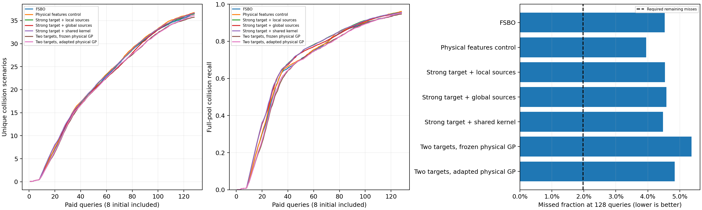

# 强目标适配与历史来源核的开发比较

完整200项运行；目标深核每轮从历史初始化出发做10步适配，全部分量用查询前概率更新同一层可靠性权重。
target_local只组合冻结物理GP与目标深核；gp_target_local只组合从零适配的物理GP与目标深核。两者均参与最强基线选择。

| 方法 | 平均碰撞数 | 平均召回率 | 发现AUC |
|---|---:|---:|---:|
| fsbo | 36.600 | 95.47093% | 22.048 |
| gp_collision | 28.675 | 85.05023% | 16.031 |
| gp_target_local | 36.150 | 95.15489% | 21.659 |
| hybrid_global | 36.600 | 95.41889% | 22.053 |
| hybrid_local | 36.450 | 95.46467% | 22.291 |
| hybrid_shared | 36.625 | 95.52306% | 22.365 |
| kinematic_kernel | 36.750 | 96.05163% | 22.388 |
| nearest_residual | 30.300 | 87.47225% | 17.938 |
| pooled_ft | 35.575 | 94.43816% | 22.502 |
| target_local | 35.750 | 94.62871% | 21.594 |

门槛：not_passed；最强基线：kinematic_kernel；要求召回率至少98.02581522%。
该轮只改变目标独立分量与权重组织，仍使用原历史编码器；正式独立验证前须重新训练与最终推断匹配的历史模型。
原首轮与后续失败结果保持原样；开发互补性并集并不代表128次查询能实现的收益。

独立审计通过：200运行、25,600条原始付费反馈及可靠性更新；143,360次来源分量概率重建；600次FSBO、120次从零GP数值预测检查；600次完整候选库贪心选点复核。概率、权重、分母和账本反馈四项人工损坏均被审计拒绝，原文件未修改。

累计1,120项发现运行、143,360次等效查询，新增物理调用为零。该轮不支持以强化目标分量或一般融合解决历史来源收益问题；整体目标仍未完成。
