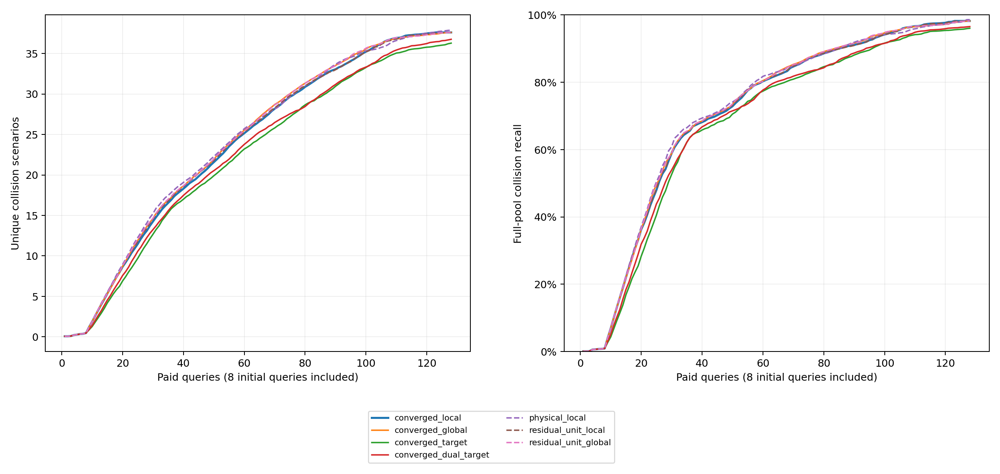

# 收敛来源推断的碰撞发现比较

完整160项开发运行通过独立审计。主方法门槛：`not_passed`；最强参考：`physical_local`。

| 方法 | 平均去重碰撞数 | 平均召回率 | 发现曲线AUC |
|---|---:|---:|---:|
| converged_local | 37.600000 | 98.195405% | 23.807227 |
| converged_global | 37.600000 | 98.177125% | 24.049219 |
| converged_target | 36.275000 | 96.019845% | 22.117383 |
| converged_dual_target | 36.750000 | 96.519845% | 22.505469 |
| physical_local | 37.875000 | 98.585721% | 24.098828 |
| residual_unit_local | 37.575000 | 98.168231% | 23.891602 |
| residual_unit_global | 37.600000 | 98.177125% | 24.063672 |

主方法在运行前指定为局部权重版。全局版、目标控制和旧失败结论完整保留；不按结果改换主方法。
数值求解修正不单独作为创新。完整38种方法、预算点、配对分层区间、条件与成本见report.json。
所有查询来自隔离执行档案回放；全库标签和召回分母只在评估端读取。未自动进入C/D/E。
