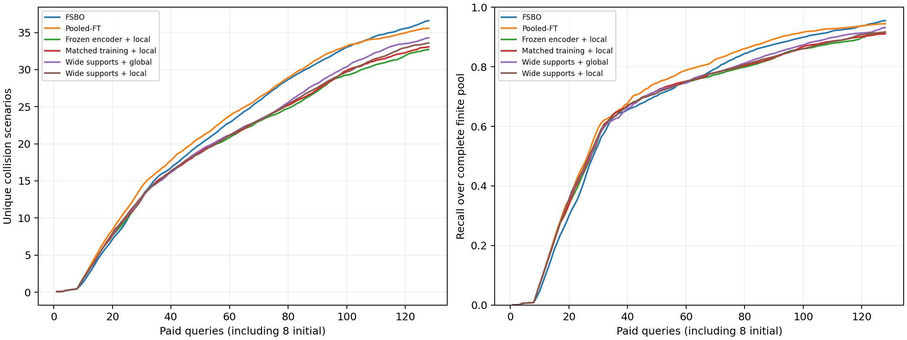

# 开发诊断汇总

原主矩阵与两项诊断共680项搜索、87,040次等效查询、新增物理调用为零。
额外训练8个同规模历史响应模型，并完成360+160项配对预测验证；训练与验证开销独立保存。

| 方法 | 平均去重碰撞数 | 平均召回率 | 发现 AUC |
|---|---:|---:|---:|
| FSBO | 36.600 | 95.47% | 22.048 |
| Pooled-FT | 35.575 | 94.44% | 22.502 |
| Frozen encoder + local | 32.725 | 91.63% | 20.018 |
| Matched training + local | 33.075 | 91.05% | 20.234 |
| Wide supports + global | 34.300 | 93.14% | 20.628 |
| Wide supports + local | 33.600 | 91.66% | 20.363 |

扩大元训练支持集改善了全局权重原型，但当前最好原型仍低于强基线。局部权重尚未显示必要性。
原5个百分点门槛在FSBO召回率95.4709%时不可达，原门槛保持未通过；未启动C/D/E。
下一轮的成功判据或实验条件仍待明确，整体研究目标未完成。
