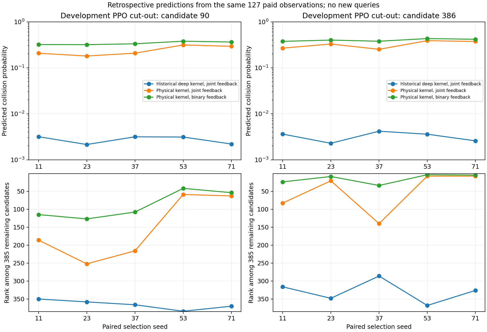

# 相同付费前缀下的物理特征诊断

40个既定开发任务，各使用联合主方法的前127次已付费反馈。三种预测器共120项比较。
完整标签只在评估端计算剩余385点的误差和真实碰撞排名；没有新增选例或物理调用。
这不是新的128查询搜索结果。

| 预测器 | 谱系等权碰撞NLL | Brier |
|---|---:|---:|
| deep_joint | 0.069230 | 0.009309 |
| physical_joint | 0.477288 | 0.150048 |
| physical_binary | 0.492231 | 0.156567 |

物理联合GP使用原始归一化场景特征，无历史拟合，6个标量参数；物理二值GP为原3参数分类核。
深核联合GP使用冻结历史模型。联合模型使用相同的付费碰撞/间距；物理二值GP只用碰撞。
配置在计算前登记，未按结果搜索参数。

| PPO切出漏检点 | 预测器 | 碰撞概率范围 | 剩余排名范围 |
|---|---|---:|---:|
| 90 | deep_joint | 0.002144–0.003167 | 350–384 |
| 90 | physical_joint | 0.180332–0.313582 | 59–252 |
| 90 | physical_binary | 0.318092–0.377704 | 42–127 |
| 386 | deep_joint | 0.002281–0.004171 | 286–368 |
| 386 | physical_joint | 0.252023–0.387923 | 8–140 |
| 386 | physical_binary | 0.374857–0.431372 | 4–34 |

深核的全剩余库平均NLL/Brier更好，物理核对两项PPO漏检的排名更靠前。
这支持检查互补，不能支持整体替换历史模型，也不能把排名改善解释成已经发现。
实际选例会改变后续反馈，在线收益仍需完整配对搜索验证。

两个物理模型在PPO切出种子11的全部512点预测经独立NumPy重建，
最大绝对差均小于5.56e-16，见numerical_checks.json。PNG已目视检查，另有SVG/PDF。

本分析为开发后诊断；正式目标未参与。完整标签没有发送给选择器。
