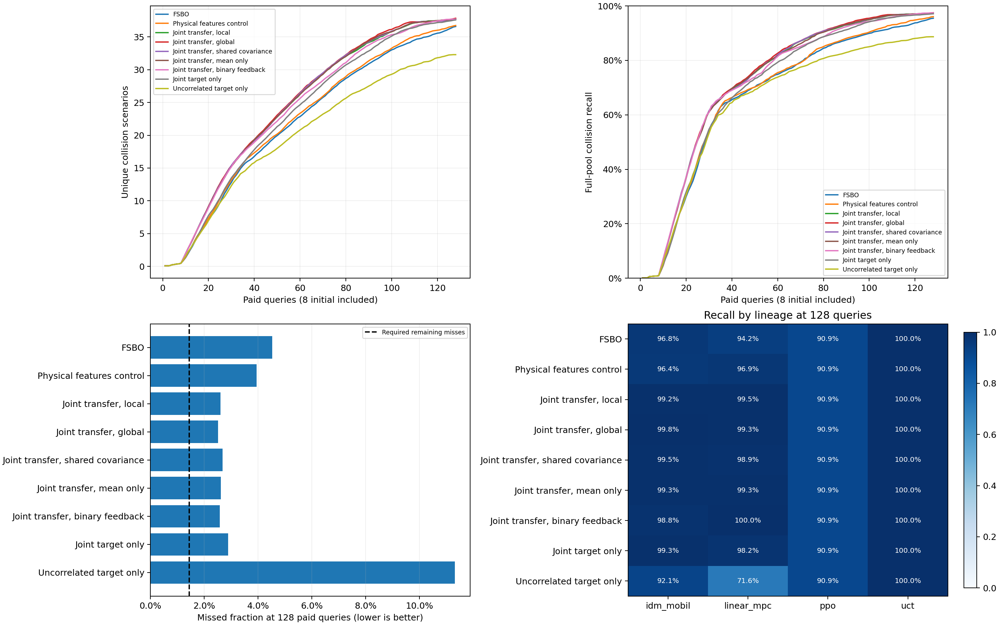

# 联合碰撞与间距后验的开发结果

完整280项运行，初始化计入128次预算；真实碰撞只按布尔标记统计。
joint_target和joint_uncorrelated获得相同已付费碰撞/间距反馈，并参与最强基线选择。

| 方法 | 平均碰撞数 | 平均召回率 | 发现AUC |
|---|---:|---:|---:|
| fsbo | 36.600 | 95.47093% | 22.048 |
| gp_collision | 28.675 | 85.05023% | 16.031 |
| gp_target_local | 36.150 | 95.15489% | 21.659 |
| joint_binary | 37.725 | 97.42218% | 24.120 |
| joint_global | 37.850 | 97.48987% | 24.686 |
| joint_local | 37.750 | 97.39946% | 24.523 |
| joint_mean | 37.750 | 97.37994% | 24.528 |
| joint_shared | 37.725 | 97.31744% | 24.570 |
| joint_target | 37.600 | 97.10968% | 23.412 |
| joint_uncorrelated | 32.300 | 88.67367% | 19.923 |
| kinematic_kernel | 36.750 | 96.05163% | 22.388 |
| nearest_residual | 30.300 | 87.47225% | 17.938 |
| pooled_ft | 35.575 | 94.43816% | 22.502 |
| target_local | 35.750 | 94.62871% | 21.594 |

门槛：not_passed；最强基线：joint_target；要求召回率至少98.55484190%。
结构、在线信息与一般多任务学习的收益由各消融分别判断；未改善发现的完整协方差不保留为最终贡献。
全部结果仍属于开发阶段，不能代替独立目标验证。原首轮与后续失败结果完整保留。

独立复核通过全部280项运行、35,840条付费碰撞/间距反馈及可靠性更新，并在840个查询前状态以NumPy重建全库概率和实际选点。16个历史来源后验已独立检查。六项人工损坏均被拒绝，原记录保持不变。

| 方法 | 查询预算 | 平均碰撞数 | 平均召回率 |
|---|---:|---:|---:|
| FSBO | 16 | 4.975 | 21.00716% |
| FSBO | 32 | 13.875 | 57.78297% |
| FSBO | 64 | 24.025 | 76.48160% |
| FSBO | 128 | 36.600 | 95.47093% |
| Physical features control | 16 | 5.100 | 20.76291% |
| Physical features control | 32 | 14.100 | 57.49620% |
| Physical features control | 64 | 24.475 | 77.09366% |
| Physical features control | 128 | 36.750 | 96.05163% |
| Joint transfer, local | 16 | 6.300 | 25.58144% |
| Joint transfer, local | 32 | 16.200 | 63.43679% |
| Joint transfer, local | 64 | 27.575 | 84.03332% |
| Joint transfer, local | 128 | 37.750 | 97.39946% |
| Joint transfer, global | 16 | 6.250 | 24.99962% |
| Joint transfer, global | 32 | 16.275 | 63.41861% |
| Joint transfer, global | 64 | 27.800 | 84.59695% |
| Joint transfer, global | 128 | 37.850 | 97.48987% |
| Joint transfer, shared covariance | 16 | 6.300 | 25.58144% |
| Joint transfer, shared covariance | 32 | 16.250 | 63.52770% |
| Joint transfer, shared covariance | 64 | 27.775 | 84.32754% |
| Joint transfer, shared covariance | 128 | 37.725 | 97.31744% |
| Joint transfer, mean only | 16 | 6.200 | 24.90871% |
| Joint transfer, mean only | 32 | 16.125 | 63.31747% |
| Joint transfer, mean only | 64 | 27.475 | 83.44270% |
| Joint transfer, mean only | 128 | 37.750 | 97.37994% |
| Joint transfer, binary feedback | 16 | 6.200 | 25.57245% |
| Joint transfer, binary feedback | 32 | 16.150 | 63.99704% |
| Joint transfer, binary feedback | 64 | 26.800 | 83.23781% |
| Joint transfer, binary feedback | 128 | 37.725 | 97.42218% |
| Joint target only | 16 | 5.125 | 20.39397% |
| Joint target only | 32 | 14.375 | 57.53911% |
| Joint target only | 64 | 25.875 | 81.23067% |
| Joint target only | 128 | 37.600 | 97.10968% |
| Uncorrelated target only | 16 | 4.850 | 20.86975% |
| Uncorrelated target only | 32 | 13.225 | 56.90104% |
| Uncorrelated target only | 64 | 21.750 | 75.26899% |
| Uncorrelated target only | 128 | 32.300 | 88.67367% |

统计先在谱系内汇总再对谱系等权汇总；零碰撞任务保留在数量和成本中，召回不适用。数量与召回在同一候选库内成比例，不视为两份独立证据。配对分层自助区间见gate.json。

成本见costs.json：已有历史建库、开发全库、四个模型训练、来源后验构建、在线适配和选例分别列出。共享GPU并行运行的耗时不用于严格硬件速度比较，重叠的运行时间不相加解释为总经过时间。全矩阵新增35,840次等效查询、零次物理调用；累计1,400项有效搜索、179,200次等效查询。失败冒烟及18次重建查询另列，原失败查询数为重建值9、可确认边界8至127。

本报告为开发证据，独立目标和严格留家族尚待后续阶段，不能外推连续空间或真实道路的全部失效覆盖。
