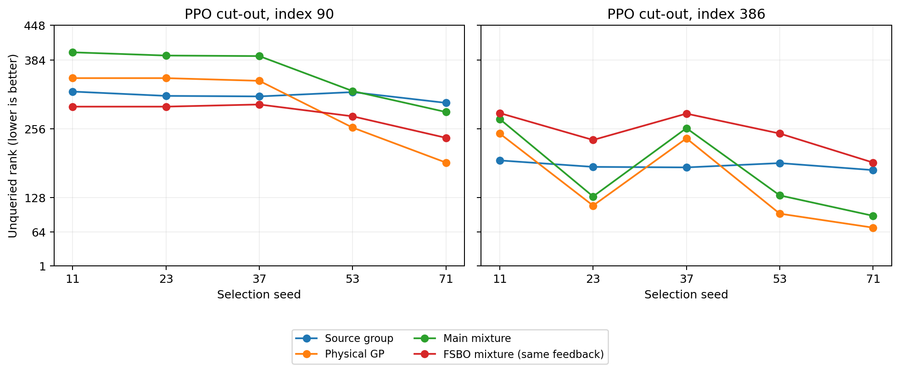

# PPO切出剩余漏检：相同付费前缀诊断

使用主方法和FSBO物理混合各五个已完成轨迹，在64、96、127次付费查询后重建预测。
共30个前缀、120项预测比较；拟合只用该前缀已付费的碰撞标签，未新增选例或物理调用。
完整标签仅用于评估剩余候选。FSBO在主方法前缀上的预测是同反馈比较，不是新的在线发现结果。

| 轨迹来源 | 前缀 | 预测器 | 剩余库平均NLL | Brier |
|---|---:|---|---:|---:|
| physical_global | 64 | fsbo | 0.072863 | 0.008141 |
| physical_global | 64 | fsbo_mixture | 0.104247 | 0.012396 |
| physical_global | 64 | group | 0.032450 | 0.004549 |
| physical_global | 64 | main_mixture | 0.061964 | 0.006323 |
| physical_global | 64 | physical | 0.471379 | 0.142344 |
| physical_global | 96 | fsbo | 0.041473 | 0.005159 |
| physical_global | 96 | fsbo_mixture | 0.065179 | 0.006882 |
| physical_global | 96 | group | 0.032062 | 0.004815 |
| physical_global | 96 | main_mixture | 0.052566 | 0.005785 |
| physical_global | 96 | physical | 0.364420 | 0.095054 |
| physical_global | 127 | fsbo | 0.033569 | 0.003618 |
| physical_global | 127 | fsbo_mixture | 0.055103 | 0.005003 |
| physical_global | 127 | group | 0.024371 | 0.003168 |
| physical_global | 127 | main_mixture | 0.044095 | 0.004024 |
| physical_global | 127 | physical | 0.291658 | 0.065801 |
| physical_fsbo | 64 | fsbo | 0.044333 | 0.005015 |
| physical_fsbo | 64 | fsbo_mixture | 0.074124 | 0.007541 |
| physical_fsbo | 64 | physical | 0.437392 | 0.126269 |
| physical_fsbo | 96 | fsbo | 0.034199 | 0.003713 |
| physical_fsbo | 96 | fsbo_mixture | 0.058465 | 0.005326 |
| physical_fsbo | 96 | physical | 0.337276 | 0.083204 |
| physical_fsbo | 127 | fsbo | 0.022420 | 0.001777 |
| physical_fsbo | 127 | fsbo_mixture | 0.045125 | 0.003003 |
| physical_fsbo | 127 | physical | 0.284718 | 0.063284 |

| 主方法127次前缀的点 | 预测器 | 尚未查询的种子数 | 概率范围 | 剩余排名范围 |
|---:|---|---:|---:|---:|
| 90 | group | 5 | 0.00441673–0.00921891 | 171–280 |
| 90 | physical | 5 | 0.217359–0.264958 | 166–277 |
| 90 | main_mixture | 5 | 0.025711–0.0341987 | 184–313 |
| 90 | fsbo_mixture | 5 | 0.0313282–0.0936211 | 17–301 |
| 386 | group | 1 | 0.00529156–0.00529156 | 171–171 |
| 386 | physical | 1 | 0.329668–0.329668 | 3–3 |
| 386 | main_mixture | 1 | 0.0377292–0.0377292 | 4–4 |
| 386 | fsbo_mixture | 1 | 0.0423643–0.0423643 | 35–35 |

在26个尚未查询的关注点/前缀比较中，有9次物理GP更偏好关注点，但混合后的实际下一点为安全场景。
具体两部分排序差、来源权重及各来源概率见report.json；该比较解释当前排序，不等同于重跑一种选例策略的收益。

| 索引90的付费前缀 | 任意非负凸混合的排名下界范围 | 剩余预算 |
|---:|---:|---:|
| 64 | 110–244 | 64 |
| 96 | 93–179 | 32 |
| 127 | 59–199 | 1 |

下界由同时在两类模型上严格高于关注点的未查询候选数计算，不搜索混合权重。
在这15个索引90的固定前缀状态下，仅改变两组非负凸混合权重，静态排名仍超出剩余预算。
该结论只约束当前固定预测；后续查询会改变反馈和模型，所以它不是任何自适应策略必然失败的证明。
下一步应检查能提供不同失效邻域的目标表示，以及查询路径怎样改变模型；不把物理质量调大视作充分修复。

75项全512点概率经独立NumPy Gaussian/Laplace推断核对，30项真实下一点概率和选点均重建通过。
两类轨迹上的物理GP使用相同初始化、核和适配设置；它们的差异来自已获得反馈的位置和标签。
分析只覆盖已确认的PPO切出开发漏检，不能外推为全部谱系或独立目标收益。

