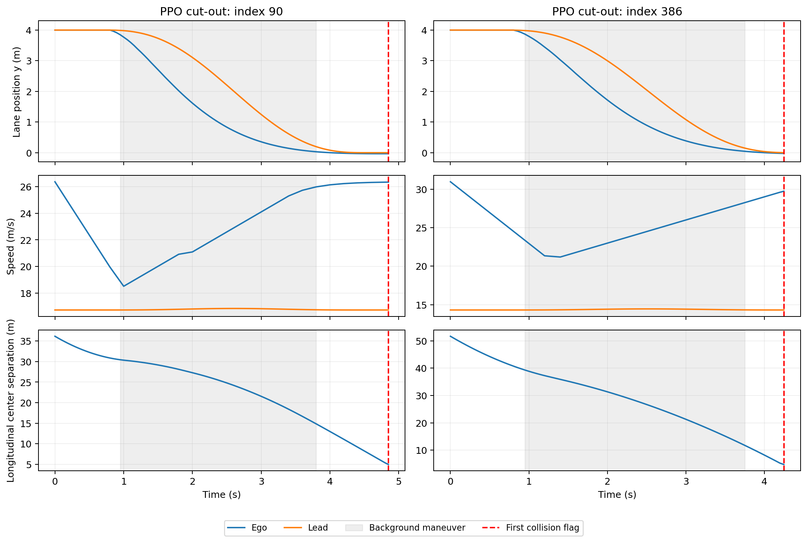

# 历史与开发场景的交互阶段诊断

完整核对切入/切出的24份历史与开发档案，共12,288条既有执行；逐条重建事件并核对碰撞标记。
相位仅用于评估端的辅助解释，未筛选候选或改变旧标签、分母、128次预算。

| 场景 | 系统 | 碰撞数 | 明显横移前 | 横移中 | 横移完成后 | 观察到横移完成的执行数 | 无碰撞且未观察到完成 |
|---|---|---:|---:|---:|---:|---:|---:|
| cut_in | history_beam | 1 | 0 | 0 | 1 | 512 | 0 |
| cut_in | history_dqn | 150 | 0 | 85 | 65 | 427 | 0 |
| cut_in | history_fvdm_lane | 97 | 0 | 96 | 1 | 416 | 0 |
| cut_in | history_idm_mobil | 87 | 0 | 85 | 2 | 427 | 0 |
| cut_in | history_linear_mpc | 44 | 0 | 44 | 0 | 468 | 0 |
| cut_in | history_nonlinear_trajectory | 71 | 0 | 67 | 4 | 445 | 0 |
| cut_in | history_ppo | 1 | 0 | 1 | 0 | 511 | 0 |
| cut_in | history_uct | 0 | 0 | 0 | 0 | 512 | 0 |
| cut_in | development_idm_mobil | 92 | 0 | 91 | 1 | 421 | 0 |
| cut_in | development_linear_mpc | 55 | 0 | 52 | 3 | 460 | 0 |
| cut_in | development_ppo | 0 | 0 | 0 | 0 | 512 | 0 |
| cut_in | development_uct | 0 | 0 | 0 | 0 | 512 | 0 |
| cut_out | history_beam | 105 | 10 | 93 | 2 | 409 | 0 |
| cut_out | history_dqn | 134 | 62 | 65 | 7 | 385 | 0 |
| cut_out | history_fvdm_lane | 116 | 11 | 89 | 16 | 412 | 0 |
| cut_out | history_idm_mobil | 81 | 11 | 65 | 5 | 436 | 0 |
| cut_out | history_linear_mpc | 24 | 13 | 10 | 1 | 489 | 0 |
| cut_out | history_nonlinear_trajectory | 44 | 13 | 30 | 1 | 469 | 0 |
| cut_out | history_ppo | 25 | 22 | 3 | 0 | 487 | 0 |
| cut_out | history_uct | 16 | 11 | 5 | 0 | 496 | 0 |
| cut_out | development_idm_mobil | 88 | 19 | 65 | 4 | 428 | 0 |
| cut_out | development_linear_mpc | 24 | 16 | 8 | 0 | 488 | 0 |
| cut_out | development_ppo | 22 | 16 | 4 | 2 | 492 | 0 |
| cut_out | development_uct | 25 | 16 | 9 | 0 | 487 | 0 |

“明显横移”及“完成”采用既有事件重建的位移/朝向阈值；发生在完成前的碰撞意味着后续阶段未被观察。
表中为执行计数。recorded_nearest_partner来自原仿真首次碰撞标记时最近对象的记录，不能单独视为精确接触对象识别。

| PPO切出方法 | 五种子平均发现：完成前碰撞 | 五种子平均发现：完成后碰撞 | 完成后碰撞池 |
|---|---:|---:|---:|
| fsbo_cuda | 20.000 | 0.000 | 2 |
| physical_fsbo | 20.000 | 1.400 | 2 |
| physical_target | 20.000 | 1.000 | 2 |
| physical_global | 20.000 | 0.800 | 2 |
| physical_local | 20.000 | 1.000 | 2 |
| joint_global | 20.000 | 0.000 | 2 |

PPO切出22次碰撞中，16次发生在明显横移前、4次在横移中、2次在横移完成后；持续漏检的90和386均属于最后一组。
两例首次碰撞时刻分别为4.85秒和4.25秒，主车已进入前车所在的相邻车道；其保存最小间距均为0。
“切出”模板包含不同阶段的失效，不能把全部碰撞都解释为障碍物暴露后的避障失败。

下一轮值得检验按交互阶段分解响应及来源可靠性；未观察到后续阶段的执行不直接充当该阶段的安全标签。
这是新的研究假设。若在线加入阶段反馈，需要与获得相同信息的目标模型比较；当前冻结实验和主方法失败结论保持不变。
新增任务的初始几何、背景运动与时序应在运行目标前验收，不按目标是否碰撞选样；旧碰撞全部保留。
