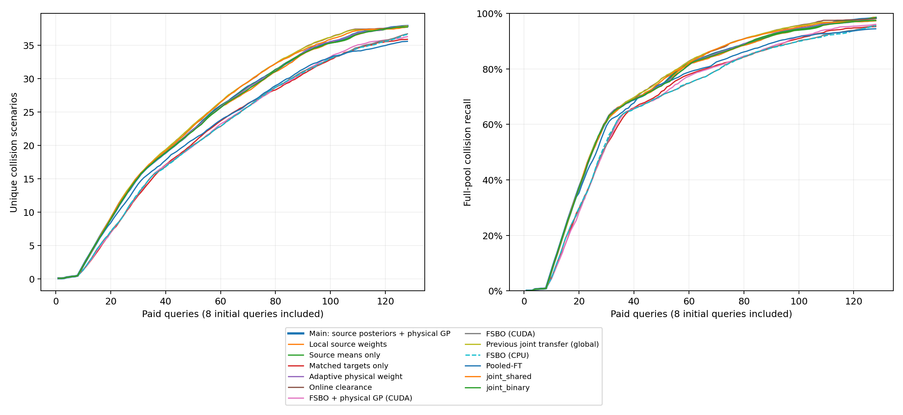

# 历史后验与独立物理GP：完整开发结果

准入：not_passed；主方法：physical_global；最强参考：joint_global。
全部320项完成并独立复核；每项128查询包含8次共同初始化。
旧CPU与新CUDA的FSBO、同一物理GP的普通混合、同表示目标模型均参与参考选择。

| 方法 | 平均真实碰撞数 | 平均召回率 | 发现AUC |
|---|---:|---:|---:|
| fsbo | 36.600 | 95.470932% | 22.048 |
| fsbo_cuda | 36.700 | 95.612319% | 22.093 |
| gp_collision | 28.675 | 85.050231% | 16.031 |
| gp_target_local | 36.150 | 95.154891% | 21.659 |
| joint_binary | 37.725 | 97.422184% | 24.120 |
| joint_global | 37.850 | 97.489872% | 24.686 |
| joint_local | 37.750 | 97.399457% | 24.523 |
| joint_mean | 37.750 | 97.379941% | 24.528 |
| joint_shared | 37.725 | 97.317441% | 24.570 |
| joint_target | 37.600 | 97.109684% | 23.412 |
| joint_uncorrelated | 32.300 | 88.673666% | 19.923 |
| kinematic_kernel | 36.750 | 96.051630% | 22.388 |
| nearest_residual | 30.300 | 87.472250% | 17.938 |
| physical_adaptive | 37.725 | 97.422184% | 24.210 |
| physical_fsbo | 36.275 | 96.019845% | 22.117 |
| physical_global | 37.875 | 98.385623% | 24.221 |
| physical_local | 37.875 | 98.585721% | 24.099 |
| physical_margin | 37.850 | 98.085227% | 24.673 |
| physical_mean | 37.850 | 98.558547% | 24.173 |
| physical_target | 35.875 | 95.257987% | 22.066 |
| pooled_ft | 35.575 | 94.438159% | 22.502 |
| target_local | 35.750 | 94.628706% | 21.594 |

| 方法 | 查询预算 | 平均碰撞数 | 平均召回率 |
|---|---:|---:|---:|
| Main: source posteriors + physical GP | 16 | 6.275 | 25.690530% |
| Main: source posteriors + physical GP | 32 | 16.150 | 64.209058% |
| Main: source posteriors + physical GP | 64 | 27.000 | 83.542902% |
| Main: source posteriors + physical GP | 128 | 37.875 | 98.385623% |
| Local source weights | 16 | 6.200 | 25.572447% |
| Local source weights | 32 | 16.275 | 64.224308% |
| Local source weights | 64 | 26.675 | 82.907131% |
| Local source weights | 128 | 37.875 | 98.585721% |
| Source means only | 16 | 6.275 | 25.690530% |
| Source means only | 32 | 16.150 | 64.209058% |
| Source means only | 64 | 26.925 | 83.443099% |
| Source means only | 128 | 37.850 | 98.558547% |
| Matched targets only | 16 | 4.575 | 19.350148% |
| Matched targets only | 32 | 13.450 | 55.690399% |
| Matched targets only | 64 | 24.775 | 79.411792% |
| Matched targets only | 128 | 35.875 | 95.257987% |
| Adaptive physical weight | 16 | 6.275 | 25.690530% |
| Adaptive physical weight | 32 | 16.250 | 64.372596% |
| Adaptive physical weight | 64 | 26.900 | 83.417161% |
| Adaptive physical weight | 128 | 37.725 | 97.422184% |
| Online clearance | 16 | 6.250 | 24.999621% |
| Online clearance | 32 | 16.225 | 63.462171% |
| Online clearance | 64 | 27.850 | 84.669582% |
| Online clearance | 128 | 37.850 | 98.085227% |
| FSBO + physical GP (CUDA) | 16 | 4.750 | 19.186034% |
| FSBO + physical GP (CUDA) | 32 | 13.725 | 56.337500% |
| FSBO + physical GP (CUDA) | 64 | 24.200 | 78.960952% |
| FSBO + physical GP (CUDA) | 128 | 36.275 | 96.019845% |
| FSBO (CUDA) | 16 | 4.975 | 21.007164% |
| FSBO (CUDA) | 32 | 13.775 | 57.241403% |
| FSBO (CUDA) | 64 | 24.075 | 76.496920% |
| FSBO (CUDA) | 128 | 36.700 | 95.612319% |
| Previous joint transfer (global) | 16 | 6.250 | 24.999621% |
| Previous joint transfer (global) | 32 | 16.275 | 63.418610% |
| Previous joint transfer (global) | 64 | 27.800 | 84.596953% |
| Previous joint transfer (global) | 128 | 37.850 | 97.489872% |
| FSBO (CPU) | 16 | 4.975 | 21.007164% |
| FSBO (CPU) | 32 | 13.875 | 57.782971% |
| FSBO (CPU) | 64 | 24.025 | 76.481604% |
| FSBO (CPU) | 128 | 36.600 | 95.470932% |
| Pooled-FT | 16 | 6.075 | 25.486479% |
| Pooled-FT | 32 | 15.125 | 62.077866% |
| Pooled-FT | 64 | 24.725 | 79.983514% |
| Pooled-FT | 128 | 35.575 | 94.438159% |
| joint_shared | 16 | 6.300 | 25.581439% |
| joint_shared | 32 | 16.250 | 63.527701% |
| joint_shared | 64 | 27.775 | 84.327536% |
| joint_shared | 128 | 37.725 | 97.317441% |
| joint_binary | 16 | 6.200 | 25.572447% |
| joint_binary | 32 | 16.150 | 63.997036% |
| joint_binary | 64 | 26.800 | 83.237813% |
| joint_binary | 128 | 37.725 | 97.422184% |

| 预算 | 该预算最强预登记参考 |
|---:|---|
| 16 | joint_shared |
| 32 | joint_binary |
| 64 | joint_global |
| 128 | joint_global |

先在谱系内汇总再对谱系等权；零碰撞任务保留数量和成本，召回不适用。
同库数量与召回不视为独立证据。配对分层区间、谱系差异和逐项门槛见gate.json。
每个预算点均对预登记强集合中的最强者另算配对区间，见curves.json；低预算结果不替换128次主门槛。
审计逐项核对完整真实碰撞分母、128条付费反馈与曲线，并独立重建960次选点。
固定质量、局部权重、来源协方差、在线间距及同信息目标模型分别由对应消融解释。
任何辅助版本更好也不改写原主方法结果。开发结论不代替独立目标、严格留家族与新场景验证。

costs.json分别记录继承的历史建库/基础训练、在线选例、两类适配和回放等效仿真成本。
相同付费前缀诊断的预测重建计算单列，不计入在线选例耗时或有效搜索运行数。
新实验不重新训练历史模型，新增物理调用为零；重叠运行时间不相加解释为总经过时间，硬件并行耗时不用于严格速度比较。
累计1,720项有效搜索、220,160次等效查询，失败尝试另列。
