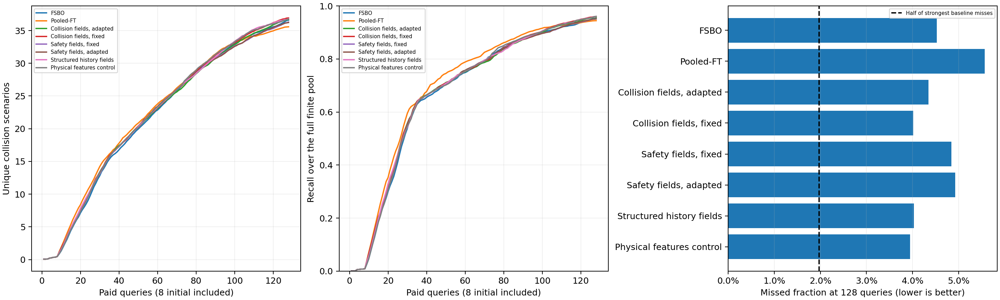

# 保留128次预算后的开发结果

用户确认保留128次预算，后续标准固定为相对最强基线减少至少50%的剩余漏检；碰撞数量不降低，至少两个谱系正收益。
首轮5个百分点门槛及其失败记录保留。原FSBO召回率95.470932%，对应新门槛97.735466%；新增物理特征对照也参与其所在轮次的最强基线选择。
三项后续实验共240运行、30,720次等效查询；累计920运行、117,760次等效查询，新增物理调用为零。全部后续运行已逐条核对原始反馈、账本、完整分母，并完成720次独立NumPy查询前概率与选点复核。

| 方法 | 平均去重碰撞数 | 平均召回率 | 发现AUC | 在线计算秒 |
|---|---:|---:|---:|---:|
| FSBO | 36.600 | 95.47093% | 22.048 | 9.587 |
| Pooled-FT | 35.575 | 94.43816% | 22.502 | 2.414 |
| Collision fields, adapted | 36.675 | 95.65827% | 22.227 | 14.366 |
| Collision fields, fixed | 36.925 | 95.98485% | 22.400 | 13.529 |
| Safety fields, fixed | 36.300 | 95.15926% | 22.164 | 32.046 |
| Safety fields, adapted | 36.225 | 95.07773% | 22.160 | 33.595 |
| Structured history fields | 36.800 | 95.97027% | 22.386 | 32.039 |
| Physical features control | 36.750 | 96.05163% | 22.388 | 13.361 |

在线计算仅指选例和目标适配；历史响应预测器构建、进程启动和物理建库成本在各运行cost中单独保存。实际运行并行执行，在线秒数不视为经过严格隔离的硬件速度比较。

| 后续阶段 | 门槛 | 漏检减少比例 |
|---|---|---:|
| recovery | not_passed | 4.1363% |
| safety_response | not_passed | -6.8817% |
| geometry_search | not_passed | -2.0605% |

各轮主方法均在运行前指定，辅助版本即使更好也不自动替代主方法。配对分层自助区间、完整谱系和逐项机制检查保留在各gate.json。
连续安全信息与相对运动特征是不同的改变。历史预测Brier/MAE改善不等于碰撞发现机制成立；若物理特征对照解释收益，不认定历史响应迁移成立。
这些仍是开发结果。C/D/E的准入和独立目标验证必须另行满足，不能将本报告写为正式独立验证成功。
