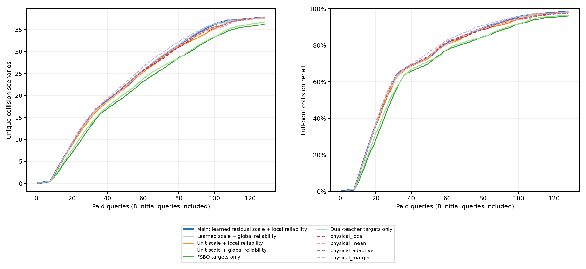

# 历史残差尺度：完整开发结果

开发准入：not_passed；主方法：residual_local；最强参考：physical_local。
240项冻结运行已全部完成并独立复核；每项128次查询包括8次共同初始化。
此前22种参考和两个目标控制共同参与最强参考选择，主配置不依据辅助版本结果更换。

| 方法 | 平均真实碰撞数 | 平均召回率 | 发现AUC |
|---|---:|---:|---:|
| fsbo | 36.600 | 95.470932% | 22.048 |
| fsbo_cuda | 36.700 | 95.612319% | 22.093 |
| gp_collision | 28.675 | 85.050231% | 16.031 |
| gp_target_local | 36.150 | 95.154891% | 21.659 |
| joint_binary | 37.725 | 97.422184% | 24.120 |
| joint_global | 37.850 | 97.489872% | 24.686 |
| joint_local | 37.750 | 97.399457% | 24.523 |
| joint_mean | 37.750 | 97.379941% | 24.528 |
| joint_shared | 37.725 | 97.317441% | 24.570 |
| joint_target | 37.600 | 97.109684% | 23.412 |
| joint_uncorrelated | 32.300 | 88.673666% | 19.923 |
| kinematic_kernel | 36.750 | 96.051630% | 22.388 |
| nearest_residual | 30.300 | 87.472250% | 17.938 |
| physical_adaptive | 37.725 | 97.422184% | 24.210 |
| physical_fsbo | 36.275 | 96.019845% | 22.117 |
| physical_global | 37.875 | 98.385623% | 24.221 |
| physical_local | 37.875 | 98.585721% | 24.099 |
| physical_margin | 37.850 | 98.085227% | 24.673 |
| physical_mean | 37.850 | 98.558547% | 24.173 |
| physical_target | 35.875 | 95.257987% | 22.066 |
| pooled_ft | 35.575 | 94.438159% | 22.502 |
| residual_dual_target | 36.725 | 96.474391% | 22.503 |
| residual_global | 37.750 | 98.358449% | 24.363 |
| residual_local | 37.700 | 98.304101% | 24.227 |
| residual_target | 36.275 | 96.019845% | 22.117 |
| residual_unit_global | 37.600 | 98.177125% | 24.064 |
| residual_unit_local | 37.575 | 98.168231% | 23.892 |
| target_local | 35.750 | 94.628706% | 21.594 |

| 方法 | 查询预算 | 平均碰撞数 | 平均召回率 |
|---|---:|---:|---:|
| Main: learned residual scale + local reliability | 16 | 6.175 | 25.097447% |
| Main: learned residual scale + local reliability | 32 | 15.900 | 62.932559% |
| Main: learned residual scale + local reliability | 64 | 26.725 | 82.380912% |
| Main: learned residual scale + local reliability | 128 | 37.700 | 98.304101% |
| Learned scale + global reliability | 16 | 6.200 | 25.038636% |
| Learned scale + global reliability | 32 | 16.100 | 63.108959% |
| Learned scale + global reliability | 64 | 27.025 | 82.998485% |
| Learned scale + global reliability | 128 | 37.750 | 98.358449% |
| Unit scale + local reliability | 16 | 6.050 | 24.943297% |
| Unit scale + local reliability | 32 | 15.600 | 62.441947% |
| Unit scale + local reliability | 64 | 26.500 | 81.971821% |
| Unit scale + local reliability | 128 | 37.575 | 98.168231% |
| Unit scale + global reliability | 16 | 6.050 | 24.839032% |
| Unit scale + global reliability | 32 | 15.750 | 62.600560% |
| Unit scale + global reliability | 64 | 26.675 | 82.471805% |
| Unit scale + global reliability | 128 | 37.600 | 98.177125% |
| FSBO targets only | 16 | 4.750 | 19.186034% |
| FSBO targets only | 32 | 13.725 | 56.337500% |
| FSBO targets only | 64 | 24.200 | 78.960952% |
| FSBO targets only | 128 | 36.275 | 96.019845% |
| Dual-teacher targets only | 16 | 5.100 | 20.627882% |
| Dual-teacher targets only | 32 | 14.200 | 57.341897% |
| Dual-teacher targets only | 64 | 25.025 | 79.941930% |
| Dual-teacher targets only | 128 | 36.725 | 96.474391% |
| physical_local | 16 | 6.200 | 25.572447% |
| physical_local | 32 | 16.275 | 64.224308% |
| physical_local | 64 | 26.675 | 82.907131% |
| physical_local | 128 | 37.875 | 98.585721% |
| physical_mean | 16 | 6.275 | 25.690530% |
| physical_mean | 32 | 16.150 | 64.209058% |
| physical_mean | 64 | 26.925 | 83.443099% |
| physical_mean | 128 | 37.850 | 98.558547% |
| physical_adaptive | 16 | 6.275 | 25.690530% |
| physical_adaptive | 32 | 16.250 | 64.372596% |
| physical_adaptive | 64 | 26.900 | 83.417161% |
| physical_adaptive | 128 | 37.725 | 97.422184% |
| physical_margin | 16 | 6.250 | 24.999621% |
| physical_margin | 32 | 16.225 | 63.462171% |
| physical_margin | 64 | 27.850 | 84.669582% |
| physical_margin | 128 | 37.850 | 98.085227% |

先在谱系内汇总再等权平均；零碰撞库保留数量及成本、召回不适用。
数量与召回不视为两份独立证据。每个预算点对其最强预登记参考另算配对分层区间，见curves.json；终点机制区间和门槛见gate.json。
独立审计逐项核对完整碰撞分母、全部查询和720次完整候选选点，并检查40对相同参数的切出曲线一致。
双教师控制取得相同历史训练信息，只对已付费碰撞适配；不把额外表示或历史间距辅助训练单独归因为来源后验收益。
尺度由历史内部学习，基础教师曾用全部历史对象，不能将其称为严格留系统验证。尺度学习不作为单独原创贡献。
costs.json分开记录历史建设及基础训练、历史尺度学习、模型加载、来源构建、在线选例和三类适配。工作进程耗时合计不解释为并行经过时间。
失败尝试另列，开发证据不替代新交互任务、独立目标或严格留家族结果，有限池召回不外推连续空间。
累计1,960项有效搜索、250,880次等效查询；新增物理调用为零。
