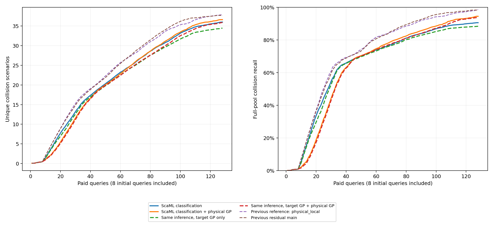

# ScaML-GP碰撞分类与同推断目标控制

完整160项、20,480次等效查询通过独立审计；最强既有参考为`physical_local`。

| 方法 | 平均去重碰撞数 | 平均召回率 | 发现曲线AUC |
|---|---:|---:|---:|
| scaml_classifier | 36.000000 | 90.578458% | 22.227734 |
| physical_scaml_classifier | 36.625000 | 94.499654% | 21.964258 |
| scaml_target | 34.475000 | 88.399012% | 21.393164 |
| physical_scaml_target | 35.900000 | 93.760343% | 21.392578 |
| physical_local | 37.875000 | 98.585721% | 24.098828 |
| residual_local | 37.700000 | 98.304101% | 24.227344 |

所有新模式共用FSBO表示适配、收敛Laplace模式及标量核优化。无来源控制不接收显式来源后验和来源均值。
原论文为连续响应高斯过程；本项目改编使用Bernoulli分类、均值中心化及固定候选的碰撞概率贪心。
新旧数值推断差异不单独归因为来源机制。完整预算点、配对分层区间和分项成本见report.json。
本比较不指定新主方法，不改既有失败结论，也不自动进入C/D/E。
