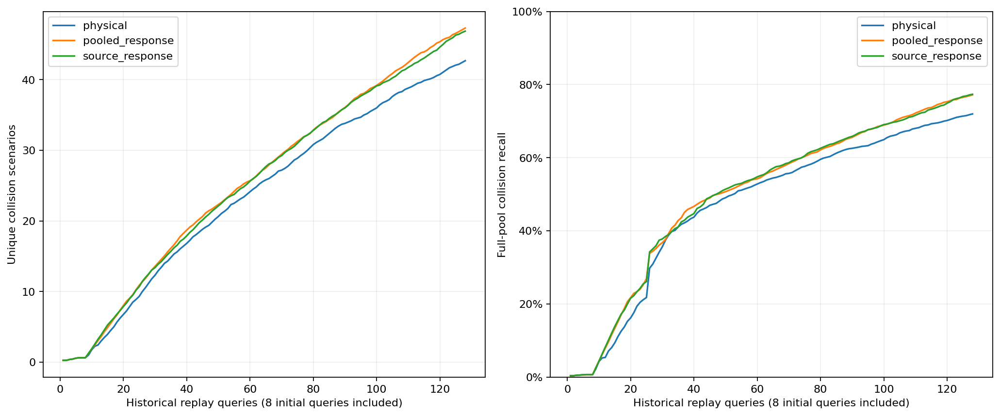

# 来源坐标交叉拟合的历史树模型筛选

每个来源预测排除其整个坐标折，自身来源也排除。80次来源重建、48项隔离回放、6,144条反馈、144次全候选选点及10项损坏控制通过。

| 输入 | 平均去重碰撞数 | 平均召回 | 发现曲线AUC |
|---|---:|---:|---:|
| physical | 42.687500 | 71.960460% | 23.817871 |
| pooled_response | 47.312500 | 77.173698% | 25.964355 |
| source_response | 46.875000 | 77.340510% | 25.718262 |

预登记历史筛选：未通过。
三个版本都重新执行，未复用坐标重合矩阵的物理控制；全部配置及原失败结论保持。
这项历史单种子检查不代表开发门槛、严格留家族或最终独立对象验证。
新增神经网络训练、开发选例及物理调用均为零；未自动进入C/D/E。

???????????????????????????????
