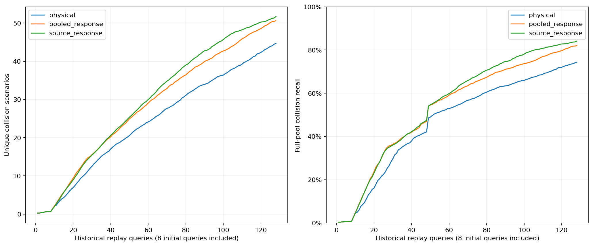

# 逐来源响应的历史树模型筛选

完整48项历史隔离回放、6,144条反馈、144组独立全候选选点及10项损坏控制通过。
每项排除自身来源，只使用其余7个历史森林，不调用旧深核教师或开发数据。

| 输入 | 平均去重碰撞数 | 平均召回 | 发现曲线AUC |
|---|---:|---:|---:|
| physical | 44.687500 | 74.366179% | 24.215332 |
| pooled_response | 50.625000 | 82.013527% | 28.581055 |
| source_response | 51.687500 | 84.108227% | 29.794434 |

预登记历史筛选：通过。
只含一个配对种子；历史对象共用来源训练坐标，不代表新坐标泛化、开发准入或最终独立验证。
树模型、逐来源特征与随机分区核均不单独宣称原创性。
冻结选择器和全部查询保持原样。审计与原始测量按规范反馈对象比较，报告使用原生数值及布尔类型。
首次审计和首次报告的序列化失败及恢复成本分别保留，不重跑历史选点。
新增神经网络训练、开发选例及物理调用均为零；未自动进入C/D/E。

???????????????????????????????
