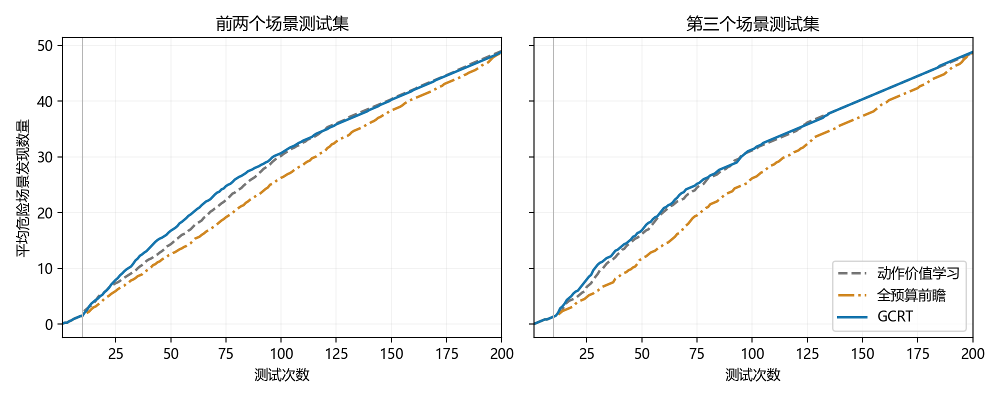
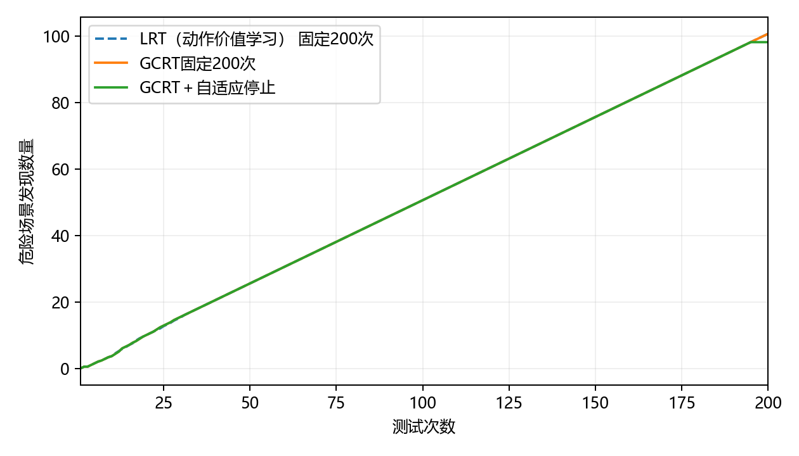

# 跟驰过程中的前车紧急制动：发现质量与完整成本

危险判定为实测风险 R>0.5。每个场景测试集有 1024 个本类候选，种子为 11；初始化 10 次计费。时间单位为秒。

## 完整 200 次的场景选择能力

| 场景测试集 | 被测驾驶控制器 | 危险总数 | LRT（动作价值学习）发现数 | 全预算前瞻发现数 | GCRT发现数 | LRT Recall | 全预算前瞻 Recall | GCRT Recall | H10 | H20 | H50 |
|---|---|---:|---:|---:|---:|---:|---:|---:|---:|---:|---:|
| 1 | FVDM | 44 | 44 | 43 | 42 | 100.00% | 97.73% | 95.45% | 0 | 5 | 26 |
| 1 | IDM | 765 | 198 | 198 | 198 | 25.88% | 25.88% | 25.88% | 8 | 18 | 48 |
| 1 | 恒速预测蒙特卡洛树搜索 | 42 | 41 | 41 | 42 | 97.62% | 97.62% | 100.00% | 0 | 5 | 20 |
| 1 | IDM＋MOBIL | 4 | 4 | 4 | 4 | 100.00% | 100.00% | 100.00% | 0 | 3 | 4 |
| 1 | PPO | 3 | 3 | 3 | 3 | 100.00% | 100.00% | 100.00% | 0 | 3 | 3 |
| 1 | 碰撞时间值迭代 | 3 | 3 | 3 | 3 | 100.00% | 100.00% | 100.00% | 0 | 3 | 3 |
| 2 | FVDM | 45 | 45 | 44 | 44 | 100.00% | 97.78% | 97.78% | 1 | 5 | 21 |
| 2 | IDM | 766 | 198 | 198 | 198 | 25.85% | 25.85% | 25.85% | 8 | 18 | 48 |
| 2 | 恒速预测蒙特卡洛树搜索 | 40 | 40 | 40 | 40 | 100.00% | 100.00% | 100.00% | 1 | 4 | 16 |
| 2 | IDM＋MOBIL | 4 | 4 | 4 | 4 | 100.00% | 100.00% | 100.00% | 0 | 3 | 4 |
| 2 | PPO | 4 | 4 | 4 | 4 | 100.00% | 100.00% | 100.00% | 0 | 1 | 4 |
| 2 | 碰撞时间值迭代 | 4 | 4 | 4 | 4 | 100.00% | 100.00% | 100.00% | 0 | 1 | 4 |
| 3 | FVDM | 45 | 42 | 42 | 43 | 93.33% | 93.33% | 95.56% | 0 | 6 | 24 |
| 3 | IDM | 771 | 197 | 197 | 197 | 25.55% | 25.55% | 25.55% | 7 | 17 | 47 |
| 3 | 恒速预测蒙特卡洛树搜索 | 44 | 44 | 44 | 44 | 100.00% | 100.00% | 100.00% | 1 | 6 | 21 |
| 3 | IDM＋MOBIL | 3 | 3 | 3 | 3 | 100.00% | 100.00% | 100.00% | 0 | 2 | 3 |
| 3 | PPO | 3 | 3 | 3 | 3 | 100.00% | 100.00% | 100.00% | 0 | 2 | 3 |
| 3 | 碰撞时间值迭代 | 3 | 3 | 3 | 3 | 100.00% | 100.00% | 100.00% | 0 | 2 | 3 |

每条完整轨迹平均有 82.83 次选择不同于当前最高危险概率候选；相对LRT（动作价值学习），平均更换了 33.17 个测试场景。

## 留出控制器上的停止与周期更新

校准使用 MCTS、PPO；后续评价使用 IDM＋MOBIL、IDM。每个控制器的三个场景测试集始终属于同一角色。经验阈值不搜索，严格阈值因只有两个校准控制器块而为 1。表中是同一收益网络的不同校正和训练设置，正式运行只加载发布的一个网络。

| 设置 | 校准方式 | 任务数 | 平均查询数 | 平均发现数 | 宏平均 Recall | 平均发现保留率 | 未保留95%的任务数 |
|---|---|---:|---:|---:|---:|---:|---:|
| 同组控制器固定200次 | 无停止 | 6 | 200.00 | 100.67 | 62.88% | 100.00% | 0 |
| 发现比例校正 | 经验校准 | 6 | 135.00 | 98.17 | 62.55% | 98.74% | 0 |
| 发现比例校正 | 严格校准 | 6 | 197.50 | 98.17 | 62.55% | 98.74% | 0 |
| 发现比例校正＋周期更新 | 经验校准 | 6 | 125.83 | 98.17 | 62.55% | 98.74% | 0 |
| 发现比例校正＋周期更新 | 严格校准 | 6 | 197.50 | 98.17 | 62.55% | 98.74% | 0 |
| 无任务内校正 | 经验校准 | 6 | 142.50 | 98.17 | 62.55% | 98.74% | 0 |
| 无任务内校正 | 严格校准 | 6 | 197.50 | 98.17 | 62.55% | 98.74% | 0 |
| 原计数直接倾斜 | 经验校准 | 6 | 122.50 | 97.83 | 51.44% | 87.62% | 1 |
| 原计数直接倾斜 | 严格校准 | 6 | 197.50 | 98.17 | 62.55% | 98.74% | 0 |

同一留出组的合并计数覆盖率：固定预算 26.11%，停止后 25.46%；停止后命中率 78.01%，预算内可发现上限平均完成 98.17%。合并计数按危险场景数量加权，宏平均按控制器等权。

### 逐任务停止结果

| 网络 | 方式 | 场景测试集 | 控制器 | 查询数 | 发现数/完整发现数 | Recall | 少发现数 | 多测次数 |
|---|---|---|---|---:|---:|---:|---:|---:|
| 发现比例校正 | 经验校准 | 1 | IDM | 195 | 193/198 | 25.23% | 5 | 4 |
| 发现比例校正 | 严格校准 | 1 | IDM | 195 | 193/198 | 25.23% | 5 | 4 |
| 发现比例校正 | 经验校准 | 1 | IDM＋MOBIL | 80 | 4/4 | 100.00% | 0 | 57 |
| 发现比例校正 | 严格校准 | 1 | IDM＋MOBIL | 200 | 4/4 | 100.00% | 0 | 177 |
| 发现比例校正 | 经验校准 | 2 | IDM | 195 | 193/198 | 25.20% | 5 | 4 |
| 发现比例校正 | 严格校准 | 2 | IDM | 195 | 193/198 | 25.20% | 5 | 4 |
| 发现比例校正 | 经验校准 | 2 | IDM＋MOBIL | 75 | 4/4 | 100.00% | 0 | 51 |
| 发现比例校正 | 严格校准 | 2 | IDM＋MOBIL | 200 | 4/4 | 100.00% | 0 | 176 |
| 发现比例校正 | 经验校准 | 3 | IDM | 195 | 192/197 | 24.90% | 5 | 4 |
| 发现比例校正 | 严格校准 | 3 | IDM | 195 | 192/197 | 24.90% | 5 | 4 |
| 发现比例校正 | 经验校准 | 3 | IDM＋MOBIL | 70 | 3/3 | 100.00% | 0 | 42 |
| 发现比例校正 | 严格校准 | 3 | IDM＋MOBIL | 200 | 3/3 | 100.00% | 0 | 172 |
| 发现比例校正＋周期更新 | 经验校准 | 1 | IDM | 195 | 193/198 | 25.23% | 5 | 4 |
| 发现比例校正＋周期更新 | 严格校准 | 1 | IDM | 195 | 193/198 | 25.23% | 5 | 4 |
| 发现比例校正＋周期更新 | 经验校准 | 1 | IDM＋MOBIL | 60 | 4/4 | 100.00% | 0 | 37 |
| 发现比例校正＋周期更新 | 严格校准 | 1 | IDM＋MOBIL | 200 | 4/4 | 100.00% | 0 | 177 |
| 发现比例校正＋周期更新 | 经验校准 | 2 | IDM | 195 | 193/198 | 25.20% | 5 | 4 |
| 发现比例校正＋周期更新 | 严格校准 | 2 | IDM | 195 | 193/198 | 25.20% | 5 | 4 |
| 发现比例校正＋周期更新 | 经验校准 | 2 | IDM＋MOBIL | 55 | 4/4 | 100.00% | 0 | 31 |
| 发现比例校正＋周期更新 | 严格校准 | 2 | IDM＋MOBIL | 200 | 4/4 | 100.00% | 0 | 176 |
| 发现比例校正＋周期更新 | 经验校准 | 3 | IDM | 195 | 192/197 | 24.90% | 5 | 4 |
| 发现比例校正＋周期更新 | 严格校准 | 3 | IDM | 195 | 192/197 | 24.90% | 5 | 4 |
| 发现比例校正＋周期更新 | 经验校准 | 3 | IDM＋MOBIL | 55 | 3/3 | 100.00% | 0 | 27 |
| 发现比例校正＋周期更新 | 严格校准 | 3 | IDM＋MOBIL | 200 | 3/3 | 100.00% | 0 | 172 |

## 构建与维护费用

| 阶段 | 独立构建耗时/秒 |
|---|---:|
| 基础核 | 38.99 |
| 历史响应关联编码器 | 412.00 |
| 统一先验拟合 | 14.13 |
| 同尺度历史选择开发、完整轨迹与因果状态 | 404.69 |
| 四折分组验证与最终收益网络训练 | 1050.09 |

一次预测头维护与历史验证：116.73 秒；选中更新步数：400。首个18任务批次采用确定性启动，后续批次使用已发布的校准规则。新增训练控制器一半随机完整执行，两个校准控制器完整执行，评价控制器自适应结束。任务顺序固定为训练、校准、后续评价，各控制器依次使用三个场景测试集的执行剖面。每18个任务计一次维护，末批保守整计；后续批次是既有工作负载的成本重建，不作为新增软件版本的效果证据。

| 复用任务数 | 固定200次平均完整成本/秒 | 自适应含维护平均完整成本/秒 | 全量1024次/秒 | 相对固定节省 | 相对全量节省 |
|---:|---:|---:|---:|---:|---:|
| 1 | 826.67 | 2399.01 | 1768.93 | -190.20% | -35.62% |
| 10 | 336.24 | 494.55 | 1432.91 | -47.08% | 65.49% |
| 50 | 285.64 | 288.39 | 1361.85 | -0.96% | 78.82% |
| 100 | 279.04 | 269.13 | 1354.52 | 3.55% | 80.13% |
| 200 | 275.22 | 255.00 | 1346.59 | 7.35% | 81.06% |

成本情景中训练、校准、评价全部18个任务合计的发现数保留比例为 98.29%，宏平均 Recall 保留比例为 99.88%。合并计数覆盖率为 33.32%。这与后续留出控制器上的停止质量分开统计。

### 启动与后续使用的任务费用剖面

后续列使用发布模型在相同已有工作负载上的前缀，用于成本重建，不作为新增控制器的独立验证。
| 测试集 | 控制器 | 启动查询数 / 发现数 | 后续查询数 / 发现数 | 完整发现数 | 后续保留95% |
|---|---|---:|---:|---:|---|
| 1 | 碰撞时间值迭代 | 200 / 3 | 200 / 3 | 3 | 是 |
| 2 | 碰撞时间值迭代 | 200 / 4 | 200 / 4 | 4 | 是 |
| 3 | 碰撞时间值迭代 | 200 / 3 | 200 / 3 | 3 | 是 |
| 1 | FVDM | 200 / 42 | 195 / 41 | 42 | 是 |
| 2 | FVDM | 200 / 44 | 185 / 44 | 44 | 是 |
| 3 | FVDM | 200 / 43 | 190 / 43 | 43 | 是 |
| 1 | 恒速预测蒙特卡洛树搜索 | 200 / 42 | 200 / 42 | 42 | 是 |
| 2 | 恒速预测蒙特卡洛树搜索 | 200 / 40 | 200 / 40 | 40 | 是 |
| 3 | 恒速预测蒙特卡洛树搜索 | 200 / 44 | 200 / 44 | 44 | 是 |
| 1 | PPO | 200 / 3 | 200 / 3 | 3 | 是 |
| 2 | PPO | 200 / 4 | 200 / 4 | 4 | 是 |
| 3 | PPO | 200 / 3 | 200 / 3 | 3 | 是 |
| 1 | IDM＋MOBIL | 60 / 4 | 60 / 4 | 4 | 是 |
| 2 | IDM＋MOBIL | 55 / 4 | 55 / 4 | 4 | 是 |
| 3 | IDM＋MOBIL | 55 / 3 | 55 / 3 | 3 | 是 |
| 1 | IDM | 195 / 193 | 195 / 193 | 198 | 是 |
| 2 | IDM | 195 / 193 | 195 / 193 | 198 | 是 |
| 3 | IDM | 195 / 192 | 195 / 192 | 197 | 是 |

### 收益校正与更新的预测误差

| 设置 | 完整剩余计数 NLL | 归一化均值误差 | 95%保留事件 Brier |
|---|---:|---:|---:|
| 原计数直接倾斜 | 0.2925 | 0.00001 | 0.04259 |
| 发现比例校正 | 0.3173 | 0.00005 | 0.03909 |
| 发现比例校正＋周期更新 | 0.2239 | 0.00004 | 0.02337 |

相对固定200次的费用交叉点：54个任务。全体任务质量达到95%门槛。全量测试的 Recall 为100%；本方法的真实 Recall 见效果表，二者同时用于判断成本收益。

## 验收与预测诊断

后续留出任务的剩余发现负对数似然：原头 0.3173，更新头 0.2239。
归一化均值误差：原头 0.00005，更新头 0.00004；固定查询位置的预测与实测续期数量见 prediction_audit.json。
历史构建费用由保存的三种规则选例计时、串行先验准备及因果记录计时重建；用于核算的重复测量单列为研究开销，不重复加入部署成本。

| 检查 | 结果 |
|---|---|
| 完整选择，前两个场景测试集 | 达到95%门槛 |
| 完整选择，第三个场景测试集 | 达到95%门槛 |
| 发现比例校正，经验校准，前两个场景测试集 | 达到95%门槛 |
| 发现比例校正，经验校准，第三个场景测试集 | 达到95%门槛 |
| 发现比例校正，严格校准，前两个场景测试集 | 达到95%门槛 |
| 发现比例校正，严格校准，第三个场景测试集 | 达到95%门槛 |
| 发现比例校正＋周期更新，经验校准，前两个场景测试集 | 达到95%门槛 |
| 发现比例校正＋周期更新，经验校准，第三个场景测试集 | 达到95%门槛 |
| 发现比例校正＋周期更新，严格校准，前两个场景测试集 | 达到95%门槛 |
| 发现比例校正＋周期更新，严格校准，第三个场景测试集 | 达到95%门槛 |
| 无任务内校正，经验校准，前两个场景测试集 | 达到95%门槛 |
| 无任务内校正，经验校准，第三个场景测试集 | 达到95%门槛 |
| 无任务内校正，严格校准，前两个场景测试集 | 达到95%门槛 |
| 无任务内校正，严格校准，第三个场景测试集 | 达到95%门槛 |
| 原计数直接倾斜，经验校准，前两个场景测试集 | 达到95%门槛 |
| 原计数直接倾斜，经验校准，第三个场景测试集 | 未达到95%门槛 |
| 原计数直接倾斜，严格校准，前两个场景测试集 | 达到95%门槛 |
| 原计数直接倾斜，严格校准，第三个场景测试集 | 达到95%门槛 |
| 复用100次完整成本 | 降低 |
| 成本情景的全体任务质量 | 达到95%门槛 |

所有任务的经验、严格及轻量诊断记录保存在 stopping.json；训练和校准角色的记录不计入后续独立停止成绩。不计算 Area。

## 场景选择与发现前置

| 规则 | H20 | H50 | H100 | H200 | 最早保留95%的测试次数 |
|---|---:|---:|---:|---:|---:|
| LRT（动作价值学习） | 5.39 | 14.94 | 30.50 | 48.89 | 83.50 |
| 完整预算前瞻 | 4.28 | 12.22 | 26.22 | 48.78 | 130.06 |
| GCRT | 5.78 | 16.78 | 30.89 | 48.83 | 81.00 |

场景选择规则在历史任务上确定，见 policy.json；后续预测网络只决定停止，不改变查询顺序。

停止后的发现数量保持不变。
