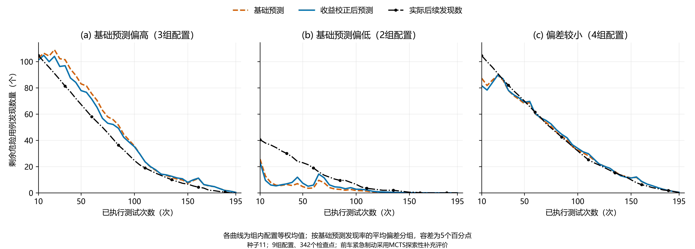
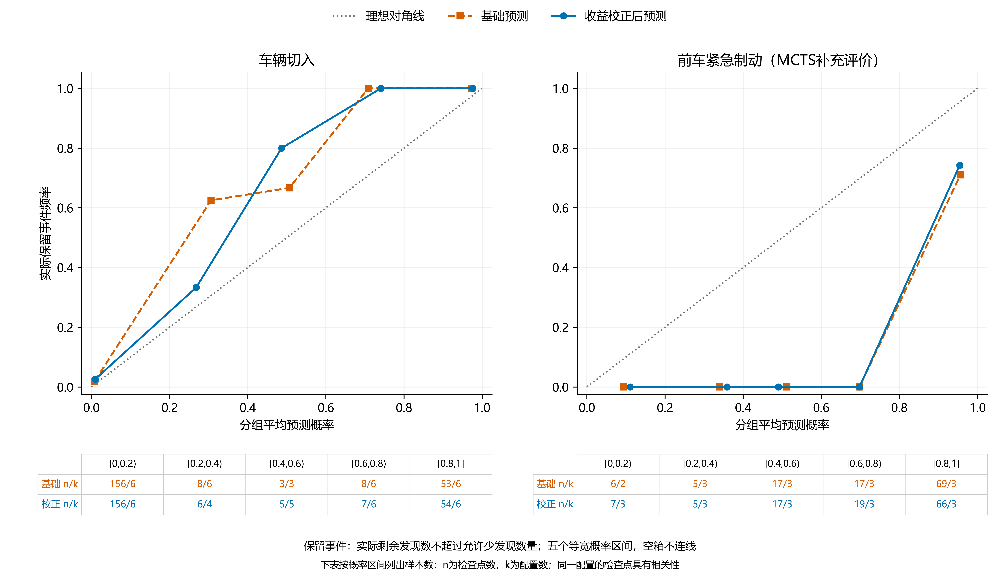

# 发现数分布校正的有效性

本目录在 9 组配置的 342 个共同检查点，比较同一基础预测分布在收益校正前后的误差、可靠性与停止表现。

## 运行

在项目根目录、`metadrive` 环境中执行：

```powershell
python -B -m methods.gcrt.calibration_effectiveness
```

需要已有模型、完整轨迹、特征缓存，以及 `retention_efficiency/` 中的预测和效率统计。准备顺序见[方法说明](../../../methods/gcrt/README.md)。本命令重新运行预测网络，不训练或新增物理仿真，并重新生成本 README、统计表、图表和交底书填写内容。

## 实验设置

车辆切入采用 IDM、IDM＋MOBIL，前车紧急制动采用 MCTS，各使用三个测试集，与[效率实验](../retention_efficiency/README.md)的 9 组配置一致。种子为 11，完整预算 200 次，初始化 10 次，每五次构成一个测试片段。MCTS 制动为探索性补充评价，原预设独立评价结果单独保留。

两种预测共用已发布的 `updated.pt` 权重和一次网络推断得到的基础分布。每组配置在第 10、15、…、195 次测试后评价，共 38 个检查点。先用已完成片段的预测与实际发现率更新系数 `u`，再校正全部剩余测试次数的发现数分布；初始化的两个片段也参与更新，实验内网络权重固定。

检查点之后的实测结果仅用于离线评分。为保证配对，两种预测均评价完整轨迹上的全部共同检查点，不按停止位置截断。危险用例按实测风险 `R > 0.5` 计数，实际剩余发现数为完整预算发现数减去当前发现数。

## 指标与统计

| 指标 | 含义 |
|---|---|
| 平均绝对误差（MAE） | 预测均值与实际剩余发现数之差的绝对值，单位为个 |
| 计数负对数似然（NLL） | 预测分布赋予实际剩余发现数的负对数概率 |
| Brier 评分 | 保留事件的预测概率与实际二元标签之差的平方 |

三项指标均越小越好。允许少发现数量 `c = floor(当前发现数 / 19)`；“保留事件”指实际剩余发现数不超过 `c`，即当前发现数至少保留完整预算发现数的 95%。

先对每组配置的检查点取平均，再对配置等权平均。标准差表示配置间差异，`delta` 为校正值减基础值。342 个检查点相互关联，不作为独立重复实验，也不估计跨种子波动。

每组配置的基础发现率平均偏差为 `d = mean((基础预测均值 - 实际剩余发现数) / 剩余测试次数)`。`d > 0.05` 为预测偏高，`d < -0.05` 为预测偏低，其余为偏差较小；分组仅用于事后分析。

## 配对预测结果

| 范围 | 配置数 | 检查点数 | MAE 基础→校正（个） | NLL 基础→校正 | Brier 基础→校正 |
|---|---:|---:|---:|---:|---:|
| 全部配置 | 9 | 342 | 7.61368 → 7.35035 | 3.24609 → 3.23563 | 0.10588 → 0.10035 |
| 车辆切入 | 6 | 228 | 7.63403 → 7.50691 | 3.04344 → 3.03876 | 0.02892 → 0.02795 |
| 前车紧急制动 | 3 | 114 | 7.57299 → 7.03722 | 3.65138 → 3.62938 | 0.25981 → 0.24516 |
| 基础预测偏高 | 3 | 114 | 10.84998 → 9.15907 | 3.02715 → 2.95066 | 0.03945 → 0.03530 |
| 基础预测偏低 | 2 | 76 | 8.29149 → 7.49377 | 3.90280 → 3.86834 | 0.30571 → 0.28514 |
| 偏差较小 | 4 | 152 | 4.84756 → 5.92209 | 3.08193 → 3.13301 | 0.05580 → 0.05675 |



图 E2a：各偏差组的剩余发现数，曲线为组内配置等权均值。



图 E2b：保留事件的预测概率与实际发生比例。概率按 0.2 间隔分为五组，概率 1 计入末组，空组不连线；`n/k` 分别为检查点数和配置数，确定性检查点也保留。

## 校正方向与停止表现

342 个检查点均通过校正方向核查。已完成片段的实际发现率高于其基础预测时，`u` 为正，预测均值提高、停止评分降低；反向偏差产生相反调整。片段反馈与事后分组考察的时段不同，符号不要求始终一致。`u` 表示发现率的对数几率偏差，`η` 表示剩余计数分布的调整系数。[典型配置表](typical_configurations.csv)列出各组最接近中位偏差的配置，等距时按配置标识排序。

两种预测分别在相同的独立校准数据上确定停止阈值：切入使用 MCTS、PPO 的 6 组配置，制动使用 PPO、IDM、IDM＋MOBIL 的 9 组配置，排除被评价的 MCTS。阈值取未达到 95% 保留目标的校准检查点最高评分，评分严格大于阈值或满足确定性条件时停止。

保留率为停止时发现数除以同一完整轨迹 200 次测试的发现数。完整预算零发现时保留率未定义，不进入保留率与达标率的分母。

| 功能场景 | 预测方法 | 配置数 | 平均测试次数 | 平均危险发现数 | 平均保留率 | 最小保留率 | 达到95%目标 |
|---|---|---:|---:|---:|---:|---:|---:|
| 全部配置 | 基础预测 | 9 | 127.22 | 85.67 | 88.75% | 40.00% | 6/9 |
| 全部配置 | 收益校正后预测 | 9 | 129.44 | 86.00 | 89.34% | 40.00% | 6/9 |
| 车辆切入 | 基础预测 | 6 | 150.83 | 113.67 | 98.15% | 95.80% | 6/6 |
| 车辆切入 | 收益校正后预测 | 6 | 152.50 | 113.83 | 98.26% | 95.80% | 6/6 |
| 前车紧急制动 | 基础预测 | 3 | 80.00 | 29.67 | 69.97% | 40.00% | 0/3 |
| 前车紧急制动 | 收益校正后预测 | 3 | 83.33 | 30.33 | 71.49% | 40.00% | 0/3 |

本次评价中，整体三项预测误差均下降，基础预测偏高与偏低组均有改善；偏差较小组的三项误差均上升。达到 95% 目标的配置数保持为 6/9，MCTS 制动的平均保留率由 69.97% 变为 71.49%，达标配置数为 0/3。结论对应这 9 组配置和固定种子 11。

## 文件索引

| 文件 | 内容 |
|---|---|
| [config.json](config.json)、[calibration.json](calibration.json) | 实验设置、权重与校准来源 |
| [checkpoint_metrics.csv](checkpoint_metrics.csv)、[configuration_metrics.csv](configuration_metrics.csv) | 检查点指标、逐配置偏差与分组 |
| [summary.csv](summary.csv) | 配对预测误差汇总 |
| [reliability_bins.csv](reliability_bins.csv)、[typical_configurations.csv](typical_configurations.csv) | 概率分组、典型配置与校正系数 |
| [stopping_metrics.csv](stopping_metrics.csv)、[stopping_summary.csv](stopping_summary.csv) | 逐配置停止结果与汇总 |
| `forecasts.json`、[audit.json](audit.json) | 可重新生成的完整配对分布缓存与核查结果 |
| [disclosure_text.md](disclosure_text.md) | 交底书第 8.3 节填写内容，含详细典型配置表 |

所有 CSV 均有同名 JSON。图片保存为 `figures/` 下的 PNG。
