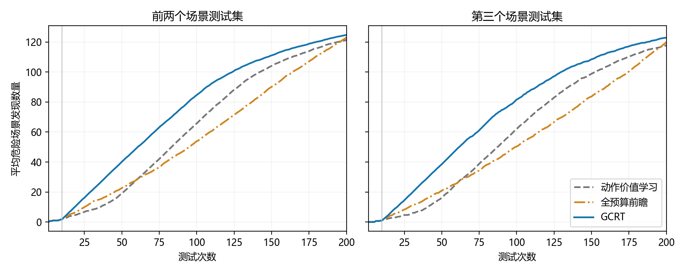
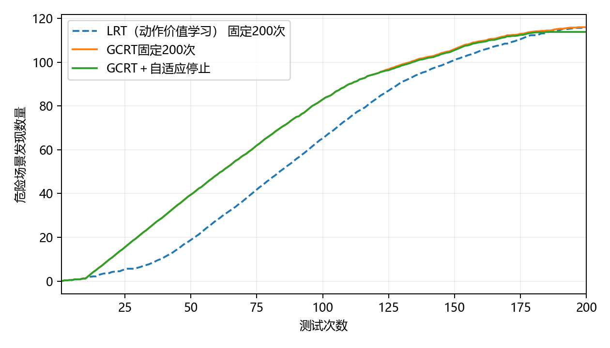

# 车辆切入：发现质量与完整成本

危险判定为实测风险 R>0.5。每个场景测试集有 1024 个本类候选，种子为 11；初始化 10 次计费。时间单位为秒。

## 完整 200 次的场景选择能力

| 场景测试集 | 被测驾驶控制器 | 危险总数 | LRT（动作价值学习）发现数 | 全预算前瞻发现数 | GCRT发现数 | LRT Recall | 全预算前瞻 Recall | GCRT Recall | H10 | H20 | H50 |
|---|---|---:|---:|---:|---:|---:|---:|---:|---:|---:|---:|
| 1 | FVDM | 100 | 100 | 100 | 100 | 100.00% | 100.00% | 100.00% | 0 | 10 | 39 |
| 1 | IDM | 145 | 143 | 138 | 143 | 98.62% | 95.17% | 98.62% | 2 | 12 | 41 |
| 1 | 恒速预测蒙特卡洛树搜索 | 138 | 125 | 123 | 122 | 90.58% | 89.13% | 88.41% | 3 | 13 | 40 |
| 1 | IDM＋MOBIL | 89 | 89 | 89 | 89 | 100.00% | 100.00% | 100.00% | 0 | 10 | 39 |
| 1 | PPO | 107 | 107 | 107 | 107 | 100.00% | 100.00% | 100.00% | 0 | 10 | 39 |
| 1 | 碰撞时间值迭代 | 397 | 168 | 184 | 195 | 42.32% | 46.35% | 49.12% | 5 | 15 | 45 |
| 2 | FVDM | 95 | 95 | 95 | 95 | 100.00% | 100.00% | 100.00% | 2 | 12 | 41 |
| 2 | IDM | 149 | 147 | 145 | 146 | 98.66% | 97.32% | 97.99% | 1 | 11 | 41 |
| 2 | 恒速预测蒙特卡洛树搜索 | 138 | 129 | 121 | 118 | 93.48% | 87.68% | 85.51% | 1 | 8 | 35 |
| 2 | IDM＋MOBIL | 88 | 88 | 88 | 88 | 100.00% | 100.00% | 100.00% | 2 | 11 | 40 |
| 2 | PPO | 104 | 104 | 104 | 104 | 100.00% | 100.00% | 100.00% | 2 | 12 | 41 |
| 2 | 碰撞时间值迭代 | 395 | 161 | 184 | 190 | 40.76% | 46.58% | 48.10% | 3 | 13 | 41 |
| 3 | FVDM | 94 | 94 | 94 | 94 | 100.00% | 100.00% | 100.00% | 1 | 10 | 38 |
| 3 | IDM | 152 | 144 | 143 | 145 | 94.74% | 94.08% | 95.39% | 1 | 10 | 40 |
| 3 | 恒速预测蒙特卡洛树搜索 | 138 | 122 | 117 | 120 | 88.41% | 84.78% | 86.96% | 0 | 7 | 36 |
| 3 | IDM＋MOBIL | 85 | 85 | 85 | 85 | 100.00% | 100.00% | 100.00% | 1 | 10 | 36 |
| 3 | PPO | 104 | 104 | 104 | 104 | 100.00% | 100.00% | 100.00% | 1 | 11 | 40 |
| 3 | 碰撞时间值迭代 | 399 | 158 | 177 | 189 | 39.60% | 44.36% | 47.37% | 2 | 11 | 41 |

每条完整轨迹平均有 89.28 次选择不同于当前最高危险概率候选；相对LRT（动作价值学习），平均更换了 26.78 个测试场景。

## 留出控制器上的停止与周期更新

校准使用 MCTS、PPO；后续评价使用 IDM＋MOBIL、IDM。每个控制器的三个场景测试集始终属于同一角色。经验阈值不搜索，严格阈值因只有两个校准控制器块而为 1。表中是同一收益网络的不同校正和训练设置，正式运行只加载发布的一个网络。

| 设置 | 校准方式 | 任务数 | 平均查询数 | 平均发现数 | 宏平均 Recall | 平均发现保留率 | 未保留95%的任务数 |
|---|---|---:|---:|---:|---:|---:|---:|
| 同组控制器固定200次 | 无停止 | 6 | 200.00 | 116.00 | 98.67% | 100.00% | 0 |
| 发现比例校正 | 经验校准 | 6 | 152.50 | 113.83 | 96.95% | 98.26% | 0 |
| 发现比例校正 | 严格校准 | 6 | 197.50 | 115.83 | 98.56% | 99.89% | 0 |
| 发现比例校正＋周期更新 | 经验校准 | 6 | 152.50 | 113.83 | 96.95% | 98.26% | 0 |
| 发现比例校正＋周期更新 | 严格校准 | 6 | 197.50 | 115.83 | 98.56% | 99.89% | 0 |
| 无任务内校正 | 经验校准 | 6 | 150.83 | 113.67 | 96.84% | 98.15% | 0 |
| 无任务内校正 | 严格校准 | 6 | 197.50 | 115.83 | 98.56% | 99.89% | 0 |
| 原计数直接倾斜 | 经验校准 | 6 | 194.17 | 115.83 | 98.56% | 99.89% | 0 |
| 原计数直接倾斜 | 严格校准 | 6 | 197.50 | 115.83 | 98.56% | 99.89% | 0 |

同一留出组的合并计数覆盖率：固定预算 98.31%，停止后 96.47%；停止后命中率 74.64%，预算内可发现上限平均完成 96.95%。合并计数按危险场景数量加权，宏平均按控制器等权。

### 逐任务停止结果

| 网络 | 方式 | 场景测试集 | 控制器 | 查询数 | 发现数/完整发现数 | Recall | 少发现数 | 多测次数 |
|---|---|---|---|---:|---:|---:|---:|---:|
| 发现比例校正 | 经验校准 | 1 | IDM | 180 | 137/143 | 94.48% | 6 | 2 |
| 发现比例校正 | 严格校准 | 1 | IDM | 195 | 143/143 | 98.62% | 0 | 17 |
| 发现比例校正 | 经验校准 | 1 | IDM＋MOBIL | 125 | 89/89 | 100.00% | 0 | 18 |
| 发现比例校正 | 严格校准 | 1 | IDM＋MOBIL | 200 | 89/89 | 100.00% | 0 | 93 |
| 发现比例校正 | 经验校准 | 2 | IDM | 185 | 144/146 | 96.64% | 2 | 19 |
| 发现比例校正 | 严格校准 | 2 | IDM | 195 | 145/146 | 97.32% | 1 | 29 |
| 发现比例校正 | 经验校准 | 2 | IDM＋MOBIL | 120 | 87/88 | 98.86% | 1 | 15 |
| 发现比例校正 | 严格校准 | 2 | IDM＋MOBIL | 200 | 88/88 | 100.00% | 0 | 95 |
| 发现比例校正 | 经验校准 | 3 | IDM | 185 | 143/145 | 94.08% | 2 | 16 |
| 发现比例校正 | 严格校准 | 3 | IDM | 195 | 145/145 | 95.39% | 0 | 26 |
| 发现比例校正 | 经验校准 | 3 | IDM＋MOBIL | 120 | 83/85 | 97.65% | 2 | 11 |
| 发现比例校正 | 严格校准 | 3 | IDM＋MOBIL | 200 | 85/85 | 100.00% | 0 | 91 |
| 发现比例校正＋周期更新 | 经验校准 | 1 | IDM | 180 | 137/143 | 94.48% | 6 | 2 |
| 发现比例校正＋周期更新 | 严格校准 | 1 | IDM | 195 | 143/143 | 98.62% | 0 | 17 |
| 发现比例校正＋周期更新 | 经验校准 | 1 | IDM＋MOBIL | 125 | 89/89 | 100.00% | 0 | 18 |
| 发现比例校正＋周期更新 | 严格校准 | 1 | IDM＋MOBIL | 200 | 89/89 | 100.00% | 0 | 93 |
| 发现比例校正＋周期更新 | 经验校准 | 2 | IDM | 185 | 144/146 | 96.64% | 2 | 19 |
| 发现比例校正＋周期更新 | 严格校准 | 2 | IDM | 195 | 145/146 | 97.32% | 1 | 29 |
| 发现比例校正＋周期更新 | 经验校准 | 2 | IDM＋MOBIL | 120 | 87/88 | 98.86% | 1 | 15 |
| 发现比例校正＋周期更新 | 严格校准 | 2 | IDM＋MOBIL | 200 | 88/88 | 100.00% | 0 | 95 |
| 发现比例校正＋周期更新 | 经验校准 | 3 | IDM | 185 | 143/145 | 94.08% | 2 | 16 |
| 发现比例校正＋周期更新 | 严格校准 | 3 | IDM | 195 | 145/145 | 95.39% | 0 | 26 |
| 发现比例校正＋周期更新 | 经验校准 | 3 | IDM＋MOBIL | 120 | 83/85 | 97.65% | 2 | 11 |
| 发现比例校正＋周期更新 | 严格校准 | 3 | IDM＋MOBIL | 200 | 85/85 | 100.00% | 0 | 91 |

## 构建与维护费用

| 阶段 | 独立构建耗时/秒 |
|---|---:|
| 基础核 | 35.61 |
| 历史响应关联编码器 | 399.78 |
| 统一先验拟合 | 14.58 |
| 同尺度历史选择开发、完整轨迹与因果状态 | 462.86 |
| 四折分组验证与最终收益网络训练 | 895.31 |

一次预测头维护与历史验证：118.38 秒；选中更新步数：0。首个18任务批次采用确定性启动，后续批次使用已发布的校准规则。新增训练控制器一半随机完整执行，两个校准控制器完整执行，评价控制器自适应结束。任务顺序固定为训练、校准、后续评价，各控制器依次使用三个场景测试集的执行剖面。每18个任务计一次维护，末批保守整计；后续批次是既有工作负载的成本重建，不作为新增软件版本的效果证据。

| 复用任务数 | 固定200次平均完整成本/秒 | 自适应含维护平均完整成本/秒 | 全量1024次/秒 | 相对固定节省 | 相对全量节省 |
|---:|---:|---:|---:|---:|---:|
| 1 | 570.16 | 2047.17 | 1374.25 | -259.05% | -48.97% |
| 10 | 212.70 | 360.01 | 1246.67 | -69.26% | 71.12% |
| 50 | 186.52 | 188.74 | 1282.72 | -1.19% | 85.29% |
| 100 | 179.98 | 166.16 | 1279.86 | 7.68% | 87.02% |
| 200 | 177.84 | 155.31 | 1281.92 | 12.67% | 87.88% |

成本情景中训练、校准、评价全部18个任务合计的发现数保留比例为 99.42%，宏平均 Recall 保留比例为 99.36%。合并计数覆盖率为 76.14%。这与后续留出控制器上的停止质量分开统计。

### 启动与后续使用的任务费用剖面

后续列使用发布模型在相同已有工作负载上的前缀，用于成本重建，不作为新增控制器的独立验证。
| 测试集 | 控制器 | 启动查询数 / 发现数 | 后续查询数 / 发现数 | 完整发现数 | 后续保留95% |
|---|---|---:|---:|---:|---|
| 1 | 碰撞时间值迭代 | 200 / 195 | 200 / 195 | 195 | 是 |
| 2 | 碰撞时间值迭代 | 200 / 190 | 200 / 190 | 190 | 是 |
| 3 | 碰撞时间值迭代 | 200 / 189 | 200 / 189 | 189 | 是 |
| 1 | FVDM | 195 / 100 | 130 / 98 | 100 | 是 |
| 2 | FVDM | 195 / 95 | 125 / 92 | 95 | 是 |
| 3 | FVDM | 200 / 94 | 125 / 89 | 94 | 否 |
| 1 | 恒速预测蒙特卡洛树搜索 | 200 / 122 | 200 / 122 | 122 | 是 |
| 2 | 恒速预测蒙特卡洛树搜索 | 200 / 118 | 200 / 118 | 118 | 是 |
| 3 | 恒速预测蒙特卡洛树搜索 | 200 / 120 | 200 / 120 | 120 | 是 |
| 1 | PPO | 200 / 107 | 200 / 107 | 107 | 是 |
| 2 | PPO | 200 / 104 | 200 / 104 | 104 | 是 |
| 3 | PPO | 200 / 104 | 200 / 104 | 104 | 是 |
| 1 | IDM＋MOBIL | 125 / 89 | 125 / 89 | 89 | 是 |
| 2 | IDM＋MOBIL | 120 / 87 | 120 / 87 | 88 | 是 |
| 3 | IDM＋MOBIL | 120 / 83 | 120 / 83 | 85 | 是 |
| 1 | IDM | 180 / 137 | 180 / 137 | 143 | 是 |
| 2 | IDM | 185 / 144 | 185 / 144 | 146 | 是 |
| 3 | IDM | 185 / 143 | 185 / 143 | 145 | 是 |

### 收益校正与更新的预测误差

| 设置 | 完整剩余计数 NLL | 归一化均值误差 | 95%保留事件 Brier |
|---|---:|---:|---:|
| 原计数直接倾斜 | 4.4379 | 0.04057 | 0.05459 |
| 发现比例校正 | 3.0388 | 0.01234 | 0.02795 |
| 发现比例校正＋周期更新 | 3.0388 | 0.01234 | 0.02795 |

相对固定200次的费用交叉点：54个任务。全体任务质量达到95%门槛。全量测试的 Recall 为100%；本方法的真实 Recall 见效果表，二者同时用于判断成本收益。

## 验收与预测诊断

后续留出任务的剩余发现负对数似然：原头 3.0388，更新头 3.0388。
归一化均值误差：原头 0.01234，更新头 0.01234；固定查询位置的预测与实测续期数量见 prediction_audit.json。
历史构建费用由保存的三种规则选例计时、串行先验准备及因果记录计时重建；用于核算的重复测量单列为研究开销，不重复加入部署成本。

| 检查 | 结果 |
|---|---|
| 完整选择，前两个场景测试集 | 达到95%门槛 |
| 完整选择，第三个场景测试集 | 达到95%门槛 |
| 发现比例校正，经验校准，前两个场景测试集 | 达到95%门槛 |
| 发现比例校正，经验校准，第三个场景测试集 | 达到95%门槛 |
| 发现比例校正，严格校准，前两个场景测试集 | 达到95%门槛 |
| 发现比例校正，严格校准，第三个场景测试集 | 达到95%门槛 |
| 发现比例校正＋周期更新，经验校准，前两个场景测试集 | 达到95%门槛 |
| 发现比例校正＋周期更新，经验校准，第三个场景测试集 | 达到95%门槛 |
| 发现比例校正＋周期更新，严格校准，前两个场景测试集 | 达到95%门槛 |
| 发现比例校正＋周期更新，严格校准，第三个场景测试集 | 达到95%门槛 |
| 无任务内校正，经验校准，前两个场景测试集 | 达到95%门槛 |
| 无任务内校正，经验校准，第三个场景测试集 | 达到95%门槛 |
| 无任务内校正，严格校准，前两个场景测试集 | 达到95%门槛 |
| 无任务内校正，严格校准，第三个场景测试集 | 达到95%门槛 |
| 原计数直接倾斜，经验校准，前两个场景测试集 | 达到95%门槛 |
| 原计数直接倾斜，经验校准，第三个场景测试集 | 达到95%门槛 |
| 原计数直接倾斜，严格校准，前两个场景测试集 | 达到95%门槛 |
| 原计数直接倾斜，严格校准，第三个场景测试集 | 达到95%门槛 |
| 复用100次完整成本 | 降低 |
| 成本情景的全体任务质量 | 达到95%门槛 |

所有任务的经验、严格及轻量诊断记录保存在 stopping.json；训练和校准角色的记录不计入后续独立停止成绩。不计算 Area。

## 场景选择与发现前置

| 规则 | H20 | H50 | H100 | H200 | 最早保留95%的测试次数 |
|---|---:|---:|---:|---:|---:|
| LRT（动作价值学习） | 4.39 | 18.17 | 64.50 | 120.17 | 158.89 |
| 完整预算前瞻 | 6.72 | 22.06 | 52.67 | 122.11 | 190.83 |
| GCRT | 10.89 | 39.61 | 83.67 | 124.11 | 148.11 |

场景选择规则在历史任务上确定，见 policy.json；后续预测网络只决定停止，不改变查询顺序。

停止后的发现数量保持不变。
