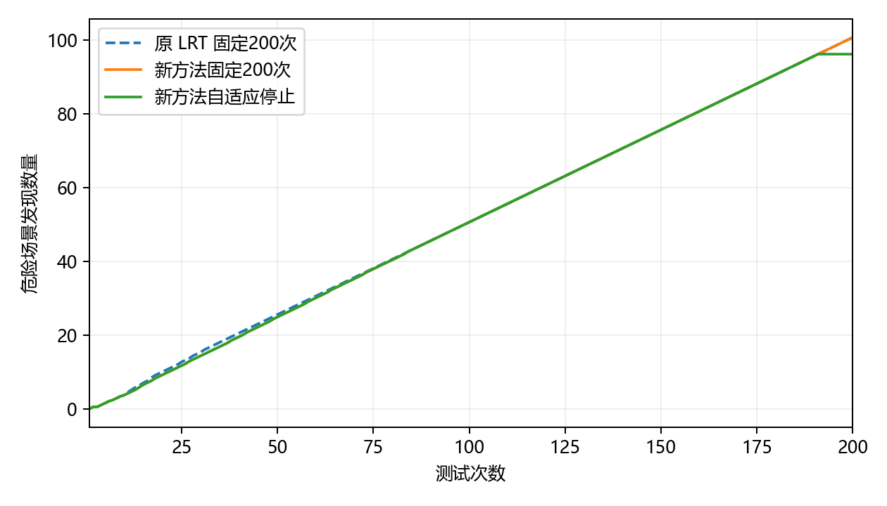

# 跟驰过程中的前车紧急制动：发现质量与完整成本

危险判定为实测风险 R>0.5。每个场景测试集有 1024 个本类候选，种子为 11；初始化 10 次计费。时间单位为秒。

## 完整 200 次的场景选择能力

| 场景测试集 | 被测驾驶控制器 | 危险总数 | 原 LRT 发现数 | 新方法发现数 | 原 LRT Recall | 新方法 Recall | H10 | H20 | H50 |
|---|---|---:|---:|---:|---:|---:|---:|---:|---:|
| 1 | FVDM | 44 | 44 | 43 | 100.00% | 97.73% | 0 | 3 | 14 |
| 1 | IDM | 765 | 198 | 198 | 25.88% | 25.88% | 8 | 18 | 48 |
| 1 | 恒速预测蒙特卡洛树搜索 | 42 | 41 | 41 | 97.62% | 97.62% | 0 | 2 | 6 |
| 1 | IDM＋MOBIL | 4 | 4 | 4 | 100.00% | 100.00% | 0 | 2 | 3 |
| 1 | PPO | 3 | 3 | 3 | 100.00% | 100.00% | 0 | 2 | 3 |
| 1 | 碰撞时间值迭代 | 3 | 3 | 3 | 100.00% | 100.00% | 0 | 1 | 3 |
| 2 | FVDM | 45 | 45 | 44 | 100.00% | 97.78% | 1 | 4 | 12 |
| 2 | IDM | 766 | 198 | 198 | 25.85% | 25.85% | 8 | 18 | 48 |
| 2 | 恒速预测蒙特卡洛树搜索 | 40 | 40 | 40 | 100.00% | 100.00% | 1 | 2 | 5 |
| 2 | IDM＋MOBIL | 4 | 4 | 4 | 100.00% | 100.00% | 0 | 1 | 2 |
| 2 | PPO | 4 | 4 | 4 | 100.00% | 100.00% | 0 | 1 | 3 |
| 2 | 碰撞时间值迭代 | 4 | 4 | 4 | 100.00% | 100.00% | 0 | 1 | 3 |
| 3 | FVDM | 45 | 42 | 42 | 93.33% | 93.33% | 0 | 3 | 10 |
| 3 | IDM | 771 | 197 | 197 | 25.55% | 25.55% | 7 | 17 | 47 |
| 3 | 恒速预测蒙特卡洛树搜索 | 44 | 44 | 44 | 100.00% | 100.00% | 1 | 2 | 9 |
| 3 | IDM＋MOBIL | 3 | 3 | 3 | 100.00% | 100.00% | 0 | 0 | 2 |
| 3 | PPO | 3 | 3 | 3 | 100.00% | 100.00% | 0 | 0 | 1 |
| 3 | 碰撞时间值迭代 | 3 | 3 | 3 | 100.00% | 100.00% | 0 | 0 | 1 |

每条完整轨迹平均有 157.61 次选择不同于当前最高危险概率候选；相对原 LRT，平均更换了 52.00 个测试场景。

## 留出控制器上的停止与周期更新

校准使用 MCTS、PPO；后续评价使用 IDM＋MOBIL、IDM。每个控制器的三个场景测试集始终属于同一角色。经验阈值不搜索，严格阈值因只有两个校准控制器块而为 1。

| 预测网络 | 校准方式 | 任务数 | 平均查询数 | 平均发现数 | 宏平均 Recall | 平均发现保留率 | 未保留95%的任务数 |
|---|---|---:|---:|---:|---:|---:|---:|
| 同组控制器固定200次 | 无停止 | 6 | 200.00 | 100.67 | 62.88% | 100.00% | 0 |
| 初始收益网络 | 经验校准 | 6 | 159.67 | 96.17 | 62.29% | 97.72% | 0 |
| 初始收益网络 | 严格校准 | 6 | 195.50 | 96.17 | 62.29% | 97.72% | 0 |
| 周期更新收益网络 | 经验校准 | 6 | 159.67 | 96.17 | 62.29% | 97.72% | 0 |
| 周期更新收益网络 | 严格校准 | 6 | 195.50 | 96.17 | 62.29% | 97.72% | 0 |
| 取消任务内校正 | 经验校准 | 6 | 195.00 | 96.17 | 62.29% | 97.72% | 0 |
| 取消任务内校正 | 严格校准 | 6 | 195.50 | 96.17 | 62.29% | 97.72% | 0 |

同一留出组的合并计数覆盖率：固定预算 26.11%，停止后 24.95%；停止后命中率 60.23%，预算内可发现上限平均完成 97.17%。合并计数按危险场景数量加权，宏平均按控制器等权。

### 逐任务停止结果

| 网络 | 方式 | 场景测试集 | 控制器 | 查询数 | 发现数/完整发现数 | Recall | 少发现数 | 多测次数 |
|---|---|---|---|---:|---:|---:|---:|---:|
| 初始收益网络 | 经验校准 | 1 | IDM | 191 | 189/198 | 24.71% | 9 | 0 |
| 初始收益网络 | 严格校准 | 1 | IDM | 191 | 189/198 | 24.71% | 9 | 0 |
| 初始收益网络 | 经验校准 | 1 | IDM＋MOBIL | 135 | 4/4 | 100.00% | 0 | 51 |
| 初始收益网络 | 严格校准 | 1 | IDM＋MOBIL | 200 | 4/4 | 100.00% | 0 | 116 |
| 初始收益网络 | 经验校准 | 2 | IDM | 191 | 189/198 | 24.67% | 9 | 0 |
| 初始收益网络 | 严格校准 | 2 | IDM | 191 | 189/198 | 24.67% | 9 | 0 |
| 初始收益网络 | 经验校准 | 2 | IDM＋MOBIL | 135 | 4/4 | 100.00% | 0 | 71 |
| 初始收益网络 | 严格校准 | 2 | IDM＋MOBIL | 200 | 4/4 | 100.00% | 0 | 136 |
| 初始收益网络 | 经验校准 | 3 | IDM | 191 | 188/197 | 24.38% | 9 | 0 |
| 初始收益网络 | 严格校准 | 3 | IDM | 191 | 188/197 | 24.38% | 9 | 0 |
| 初始收益网络 | 经验校准 | 3 | IDM＋MOBIL | 115 | 3/3 | 100.00% | 0 | 42 |
| 初始收益网络 | 严格校准 | 3 | IDM＋MOBIL | 200 | 3/3 | 100.00% | 0 | 127 |
| 周期更新收益网络 | 经验校准 | 1 | IDM | 191 | 189/198 | 24.71% | 9 | 0 |
| 周期更新收益网络 | 严格校准 | 1 | IDM | 191 | 189/198 | 24.71% | 9 | 0 |
| 周期更新收益网络 | 经验校准 | 1 | IDM＋MOBIL | 135 | 4/4 | 100.00% | 0 | 51 |
| 周期更新收益网络 | 严格校准 | 1 | IDM＋MOBIL | 200 | 4/4 | 100.00% | 0 | 116 |
| 周期更新收益网络 | 经验校准 | 2 | IDM | 191 | 189/198 | 24.67% | 9 | 0 |
| 周期更新收益网络 | 严格校准 | 2 | IDM | 191 | 189/198 | 24.67% | 9 | 0 |
| 周期更新收益网络 | 经验校准 | 2 | IDM＋MOBIL | 135 | 4/4 | 100.00% | 0 | 71 |
| 周期更新收益网络 | 严格校准 | 2 | IDM＋MOBIL | 200 | 4/4 | 100.00% | 0 | 136 |
| 周期更新收益网络 | 经验校准 | 3 | IDM | 191 | 188/197 | 24.38% | 9 | 0 |
| 周期更新收益网络 | 严格校准 | 3 | IDM | 191 | 188/197 | 24.38% | 9 | 0 |
| 周期更新收益网络 | 经验校准 | 3 | IDM＋MOBIL | 115 | 3/3 | 100.00% | 0 | 42 |
| 周期更新收益网络 | 严格校准 | 3 | IDM＋MOBIL | 200 | 3/3 | 100.00% | 0 | 127 |

## 构建与维护费用

| 阶段 | 独立构建耗时/秒 |
|---|---:|
| 基础核 | 38.99 |
| 历史响应关联编码器 | 412.00 |
| 统一先验拟合 | 14.13 |
| 完整历史轨迹与因果状态 | 171.98 |
| 剩余发现网络训练、验证与局部参数选择 | 414.74 |

一次预测头维护与历史验证：42.74 秒；选中更新步数：0。生命周期费用按本轮实际角色比例计算：新增训练控制器一半随机完整执行，两个校准控制器完整执行，评价控制器自适应结束。每18个任务计一次维护；这是部署成本情景，不将场景重采样称为软件版本演进。

| 复用任务数 | 固定200次平均完整成本/秒 | 自适应含维护平均完整成本/秒 | 全量1024次/秒 | 相对固定节省 | 相对全量节省 |
|---:|---:|---:|---:|---:|---:|
| 1 | 732.55 | 1305.23 | 1345.81 | -78.18% | 3.02% |
| 10 | 313.09 | 357.72 | 1345.81 | -14.26% | 73.42% |
| 50 | 275.80 | 273.50 | 1345.81 | 0.84% | 79.68% |
| 100 | 271.14 | 262.97 | 1345.81 | 3.01% | 80.46% |
| 200 | 268.81 | 257.71 | 1345.81 | 4.13% | 80.85% |

成本情景中训练、校准、评价全部18个任务合计的发现数保留比例为 96.58%，宏平均 Recall 保留比例为 99.35%。这与后续留出控制器上的停止质量分开统计。

相对固定200次的费用交叉点：42个任务。全体任务质量达到95%门槛。全量测试的 Recall 为100%；本方法的真实 Recall 见效果表，二者同时用于判断成本收益。

## 验收与预测诊断

后续留出任务的剩余发现负对数似然：原头 0.5769，更新头 0.5769。
归一化均值误差：原头 0.00009，更新头 0.00009；固定查询位置的预测与实测续期数量见 prediction_audit.json。

| 检查 | 结果 |
|---|---|
| 完整选择，前两个场景测试集 | 达到95%门槛 |
| 完整选择，第三个场景测试集 | 达到95%门槛 |
| 初始收益网络，经验校准，前两个场景测试集 | 达到95%门槛 |
| 初始收益网络，经验校准，第三个场景测试集 | 达到95%门槛 |
| 初始收益网络，严格校准，前两个场景测试集 | 达到95%门槛 |
| 初始收益网络，严格校准，第三个场景测试集 | 达到95%门槛 |
| 周期更新收益网络，经验校准，前两个场景测试集 | 达到95%门槛 |
| 周期更新收益网络，经验校准，第三个场景测试集 | 达到95%门槛 |
| 周期更新收益网络，严格校准，前两个场景测试集 | 达到95%门槛 |
| 周期更新收益网络，严格校准，第三个场景测试集 | 达到95%门槛 |
| 取消任务内校正，经验校准，前两个场景测试集 | 达到95%门槛 |
| 取消任务内校正，经验校准，第三个场景测试集 | 达到95%门槛 |
| 取消任务内校正，严格校准，前两个场景测试集 | 达到95%门槛 |
| 取消任务内校正，严格校准，第三个场景测试集 | 达到95%门槛 |
| 复用100次完整成本 | 降低 |
| 成本情景的全体任务质量 | 达到95%门槛 |

所有任务的经验、严格及轻量诊断记录保存在 stopping.json；训练和校准角色的记录不计入后续独立停止成绩。不计算 Area。

## 轻量停止诊断

以下仅使用留出的 IDM＋MOBIL、IDM，同一网络与同一完整查询顺序。

| 设置 | 平均查询数 | 平均发现数 | 宏平均 Recall | H10 | H20 | H50 | 未保留95%的任务数 |
|---|---:|---:|---:|---:|---:|---:|---:|
| 均值停止 | 190.50 | 96.17 | 62.29% | 3.83 | 9.33 | 25.00 | 0 |
| 历史验证阈值，未作目标任务校准 | 191.50 | 96.17 | 62.29% | 3.83 | 9.33 | 25.00 | 0 |

停止后的发现数量保持不变。
