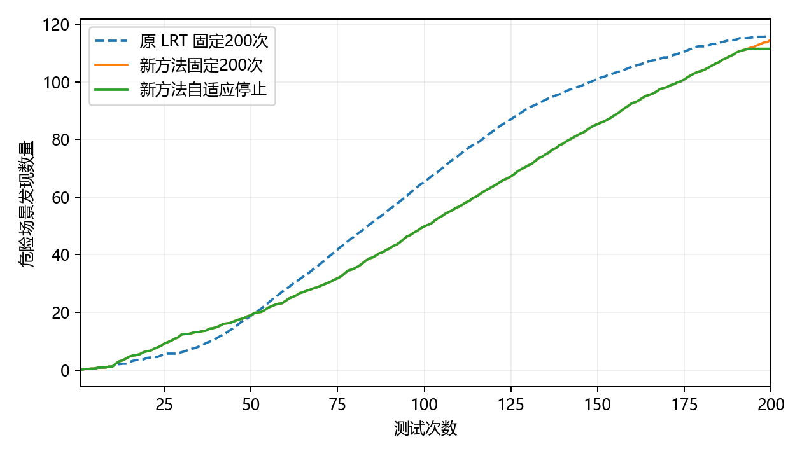

# 车辆切入：发现质量与完整成本

危险判定为实测风险 R>0.5。每个场景测试集有 1024 个本类候选，种子为 11；初始化 10 次计费。时间单位为秒。

## 完整 200 次的场景选择能力

| 场景测试集 | 被测驾驶控制器 | 危险总数 | 原 LRT 发现数 | 新方法发现数 | 原 LRT Recall | 新方法 Recall | H10 | H20 | H50 |
|---|---|---:|---:|---:|---:|---:|---:|---:|---:|
| 1 | FVDM | 100 | 100 | 100 | 100.00% | 100.00% | 0 | 6 | 21 |
| 1 | IDM | 145 | 143 | 138 | 98.62% | 95.17% | 2 | 7 | 23 |
| 1 | 恒速预测蒙特卡洛树搜索 | 138 | 125 | 123 | 90.58% | 89.13% | 3 | 5 | 22 |
| 1 | IDM＋MOBIL | 89 | 89 | 89 | 100.00% | 100.00% | 0 | 5 | 19 |
| 1 | PPO | 107 | 107 | 107 | 100.00% | 100.00% | 0 | 6 | 21 |
| 1 | 碰撞时间值迭代 | 397 | 168 | 184 | 42.32% | 46.35% | 5 | 11 | 36 |
| 2 | FVDM | 95 | 95 | 95 | 100.00% | 100.00% | 2 | 8 | 22 |
| 2 | IDM | 149 | 147 | 145 | 98.66% | 97.32% | 1 | 7 | 19 |
| 2 | 恒速预测蒙特卡洛树搜索 | 138 | 129 | 121 | 93.48% | 87.68% | 1 | 6 | 22 |
| 2 | IDM＋MOBIL | 88 | 88 | 88 | 100.00% | 100.00% | 2 | 7 | 17 |
| 2 | PPO | 104 | 104 | 104 | 100.00% | 100.00% | 2 | 7 | 15 |
| 2 | 碰撞时间值迭代 | 395 | 161 | 184 | 40.76% | 46.58% | 3 | 9 | 35 |
| 3 | FVDM | 94 | 94 | 94 | 100.00% | 100.00% | 1 | 7 | 20 |
| 3 | IDM | 152 | 144 | 143 | 94.74% | 94.08% | 1 | 6 | 23 |
| 3 | 恒速预测蒙特卡洛树搜索 | 138 | 122 | 117 | 88.41% | 84.78% | 0 | 3 | 23 |
| 3 | IDM＋MOBIL | 85 | 85 | 85 | 100.00% | 100.00% | 1 | 7 | 13 |
| 3 | PPO | 104 | 104 | 104 | 100.00% | 100.00% | 1 | 9 | 17 |
| 3 | 碰撞时间值迭代 | 399 | 158 | 177 | 39.60% | 44.36% | 2 | 5 | 29 |

每条完整轨迹平均有 180.78 次选择不同于当前最高危险概率候选；相对原 LRT，平均更换了 32.28 个测试场景。

## 留出控制器上的停止与周期更新

校准使用 MCTS、PPO；后续评价使用 IDM＋MOBIL、IDM。每个控制器的三个场景测试集始终属于同一角色。经验阈值不搜索，严格阈值因只有两个校准控制器块而为 1。

| 预测网络 | 校准方式 | 任务数 | 平均查询数 | 平均发现数 | 宏平均 Recall | 平均发现保留率 | 未保留95%的任务数 |
|---|---|---:|---:|---:|---:|---:|---:|
| 同组控制器固定200次 | 无停止 | 6 | 200.00 | 114.67 | 97.76% | 100.00% | 0 |
| 初始收益网络 | 经验校准 | 6 | 192.83 | 111.50 | 95.02% | 97.20% | 0 |
| 初始收益网络 | 严格校准 | 6 | 194.50 | 111.67 | 95.21% | 97.39% | 0 |
| 周期更新收益网络 | 经验校准 | 6 | 192.67 | 111.50 | 95.02% | 97.20% | 0 |
| 周期更新收益网络 | 严格校准 | 6 | 194.50 | 111.67 | 95.21% | 97.39% | 0 |
| 取消任务内校正 | 经验校准 | 6 | 193.33 | 111.50 | 95.10% | 97.27% | 0 |
| 取消任务内校正 | 严格校准 | 6 | 194.50 | 111.67 | 95.21% | 97.39% | 0 |

同一留出组的合并计数覆盖率：固定预算 97.18%，停止后 94.49%；停止后命中率 57.87%，预算内可发现上限平均完成 95.02%。合并计数按危险场景数量加权，宏平均按控制器等权。

### 逐任务停止结果

| 网络 | 方式 | 场景测试集 | 控制器 | 查询数 | 发现数/完整发现数 | Recall | 少发现数 | 多测次数 |
|---|---|---|---|---:|---:|---:|---:|---:|
| 初始收益网络 | 经验校准 | 1 | IDM | 192 | 137/138 | 94.48% | 1 | 9 |
| 初始收益网络 | 严格校准 | 1 | IDM | 193 | 137/138 | 94.48% | 1 | 10 |
| 初始收益网络 | 经验校准 | 1 | IDM＋MOBIL | 194 | 85/89 | 95.51% | 4 | 0 |
| 初始收益网络 | 严格校准 | 1 | IDM＋MOBIL | 196 | 86/89 | 96.63% | 3 | 2 |
| 初始收益网络 | 经验校准 | 2 | IDM | 193 | 141/145 | 94.63% | 4 | 8 |
| 初始收益网络 | 严格校准 | 2 | IDM | 193 | 141/145 | 94.63% | 4 | 8 |
| 初始收益网络 | 经验校准 | 2 | IDM＋MOBIL | 192 | 86/88 | 97.73% | 2 | 11 |
| 初始收益网络 | 严格校准 | 2 | IDM＋MOBIL | 196 | 86/88 | 97.73% | 2 | 15 |
| 初始收益网络 | 经验校准 | 3 | IDM | 193 | 137/143 | 90.13% | 6 | 1 |
| 初始收益网络 | 严格校准 | 3 | IDM | 193 | 137/143 | 90.13% | 6 | 1 |
| 初始收益网络 | 经验校准 | 3 | IDM＋MOBIL | 193 | 83/85 | 97.65% | 2 | 4 |
| 初始收益网络 | 严格校准 | 3 | IDM＋MOBIL | 196 | 83/85 | 97.65% | 2 | 7 |
| 周期更新收益网络 | 经验校准 | 1 | IDM | 192 | 137/138 | 94.48% | 1 | 9 |
| 周期更新收益网络 | 严格校准 | 1 | IDM | 193 | 137/138 | 94.48% | 1 | 10 |
| 周期更新收益网络 | 经验校准 | 1 | IDM＋MOBIL | 194 | 85/89 | 95.51% | 4 | 0 |
| 周期更新收益网络 | 严格校准 | 1 | IDM＋MOBIL | 196 | 86/89 | 96.63% | 3 | 2 |
| 周期更新收益网络 | 经验校准 | 2 | IDM | 192 | 141/145 | 94.63% | 4 | 7 |
| 周期更新收益网络 | 严格校准 | 2 | IDM | 193 | 141/145 | 94.63% | 4 | 8 |
| 周期更新收益网络 | 经验校准 | 2 | IDM＋MOBIL | 192 | 86/88 | 97.73% | 2 | 11 |
| 周期更新收益网络 | 严格校准 | 2 | IDM＋MOBIL | 196 | 86/88 | 97.73% | 2 | 15 |
| 周期更新收益网络 | 经验校准 | 3 | IDM | 193 | 137/143 | 90.13% | 6 | 1 |
| 周期更新收益网络 | 严格校准 | 3 | IDM | 193 | 137/143 | 90.13% | 6 | 1 |
| 周期更新收益网络 | 经验校准 | 3 | IDM＋MOBIL | 193 | 83/85 | 97.65% | 2 | 4 |
| 周期更新收益网络 | 严格校准 | 3 | IDM＋MOBIL | 196 | 83/85 | 97.65% | 2 | 7 |

## 构建与维护费用

| 阶段 | 独立构建耗时/秒 |
|---|---:|
| 基础核 | 35.61 |
| 历史响应关联编码器 | 399.78 |
| 统一先验拟合 | 14.58 |
| 完整历史轨迹与因果状态 | 173.29 |
| 剩余发现网络训练、验证与局部参数选择 | 425.66 |

一次预测头维护与历史验证：70.05 秒；选中更新步数：800。生命周期费用按本轮实际角色比例计算：新增训练控制器一半随机完整执行，两个校准控制器完整执行，评价控制器自适应结束。每18个任务计一次维护；这是部署成本情景，不将场景重采样称为软件版本演进。

| 复用任务数 | 固定200次平均完整成本/秒 | 自适应含维护平均完整成本/秒 | 全量1024次/秒 | 相对固定节省 | 相对全量节省 |
|---:|---:|---:|---:|---:|---:|
| 1 | 623.12 | 1216.38 | 1283.55 | -95.21% | 5.23% |
| 10 | 217.35 | 271.56 | 1283.55 | -24.94% | 78.84% |
| 50 | 181.28 | 187.58 | 1283.55 | -3.47% | 85.39% |
| 100 | 176.77 | 177.08 | 1283.55 | -0.17% | 86.20% |
| 200 | 174.52 | 171.83 | 1283.55 | 1.54% | 86.61% |

成本情景中训练、校准、评价全部18个任务合计的发现数保留比例为 94.27%，宏平均 Recall 保留比例为 92.19%。这与后续留出控制器上的停止质量分开统计。
训练资料采集阶段：场景测试集1、FVDM 在10次结束，发现0/100；该历史阈值采集结果未达到95%保留目标，不能将其低费用解释为同质量节约。

相对固定200次的费用交叉点：106个任务。全体任务质量未达标，因此不认定为等质量回本。全量测试的 Recall 为100%；本方法的真实 Recall 见效果表，二者同时用于判断成本收益。

## 验收与预测诊断

后续留出任务的剩余发现负对数似然：原头 5.8652，更新头 6.7716。
归一化均值误差：原头 0.06037，更新头 0.07855；固定查询位置的预测与实测续期数量见 prediction_audit.json。

| 检查 | 结果 |
|---|---|
| 完整选择，前两个场景测试集 | 达到95%门槛 |
| 完整选择，第三个场景测试集 | 达到95%门槛 |
| 初始收益网络，经验校准，前两个场景测试集 | 达到95%门槛 |
| 初始收益网络，经验校准，第三个场景测试集 | 达到95%门槛 |
| 初始收益网络，严格校准，前两个场景测试集 | 达到95%门槛 |
| 初始收益网络，严格校准，第三个场景测试集 | 达到95%门槛 |
| 周期更新收益网络，经验校准，前两个场景测试集 | 达到95%门槛 |
| 周期更新收益网络，经验校准，第三个场景测试集 | 达到95%门槛 |
| 周期更新收益网络，严格校准，前两个场景测试集 | 达到95%门槛 |
| 周期更新收益网络，严格校准，第三个场景测试集 | 达到95%门槛 |
| 取消任务内校正，经验校准，前两个场景测试集 | 达到95%门槛 |
| 取消任务内校正，经验校准，第三个场景测试集 | 达到95%门槛 |
| 取消任务内校正，严格校准，前两个场景测试集 | 达到95%门槛 |
| 取消任务内校正，严格校准，第三个场景测试集 | 达到95%门槛 |
| 复用100次完整成本 | 未降低 |
| 成本情景的全体任务质量 | 未达到95%门槛 |

所有任务的经验、严格及轻量诊断记录保存在 stopping.json；训练和校准角色的记录不计入后续独立停止成绩。不计算 Area。

## 轻量停止诊断

以下仅使用留出的 IDM＋MOBIL、IDM，同一网络与同一完整查询顺序。

| 设置 | 平均查询数 | 平均发现数 | 宏平均 Recall | H10 | H20 | H50 | 未保留95%的任务数 |
|---|---:|---:|---:|---:|---:|---:|---:|
| 均值停止 | 191.50 | 111.00 | 94.53% | 1.17 | 6.50 | 19.00 | 1 |
| 历史验证阈值，未作目标任务校准 | 161.33 | 97.17 | 78.99% | 1.17 | 5.67 | 15.83 | 1 |

停止后的发现数量保持不变。
