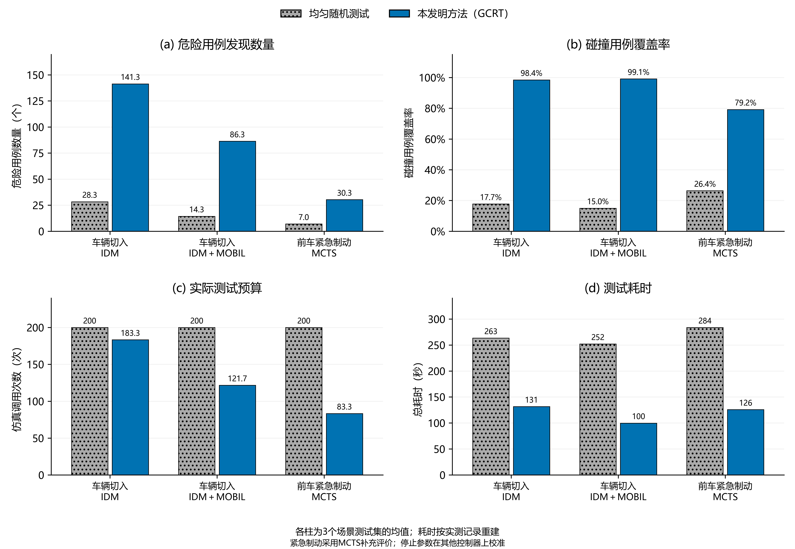

# 危险用例发现效果与测试效率

在图E1展示的9组实验配置中，GCRT累计发现774个危险用例，平均危险用例覆盖率为88.46%，平均碰撞用例覆盖率为92.23%。GCRT平均执行129.44次仿真，按实测记录重建的平均执行总耗时为118.91秒。

## 实验配置与评价指标

比较本发明方法——收益校正风险测试（GCRT）与均匀随机测试。均匀随机测试代表不使用风险预测模型的基础搜索。本实验评价本发明方法相对于该基础对照的发现效果及实际执行开销。车辆切入采用智能驾驶员模型（IDM）及其与MOBIL换道模型组合的控制器；前车紧急制动采用恒速预测蒙特卡洛树搜索控制器（MCTS）。每个功能场景与控制器组合包含3个场景测试集，每个测试集有1024个候选用例。一组实验配置指一个被测控制器在一个功能场景的一个场景测试集上的测试；图E1共展示9组配置，两种测试方法使用完全相同的场景、控制器和场景测试集。随机种子固定为11，两种方法使用相同的10个初始化用例，初始化计入实际仿真调用次数。车辆切入沿用既有发布模型和停止参数。紧急制动固定同一已发布模型权重，将MCTS从停止参数校准数据中移出，使用PPO、IDM和IDM＋MOBIL在三个场景测试集上的9组记录重新校准。训练、校准和MCTS补充评价的控制器相互分离；补充评价结果不参与停止参数计算。新增统计均复用已归档的因果预测、场景选择和实测执行记录，无新增物理仿真或训练。

危险用例发现数量为已执行用例中实测风险R>0.5的用例数。危险用例覆盖率为该数量除以相应控制器在该场景测试集全部候选用例中的危险用例总数。碰撞用例覆盖率为已执行用例中发生自车碰撞的用例数除以该场景测试集中全部自车碰撞用例数，依据实测collision标签计算。上述覆盖率的分母均来自完整候选集，不以某条测试序列的发现数作为分母。场景测试集不存在碰撞用例时，碰撞覆盖率记为缺失。全部原配置及补充配置均保留逐配置记录；本节的发现效果、实际测试次数和耗时均在图E1展示的共同配置范围内比较。实际测试预算以仿真调用次数表示。

## 补充评价范围与控制器选择

本次紧急制动控制器的更换是在查看原评价结果后进行的探索性补充评价，不作为原先预设独立评价的替代结论。MCTS具有规划控制器代表性，且完整候选集中含有真实的稀有碰撞用例，适合展示风险引导搜索对碰撞用例的集中发现能力。新停止参数由其他全部可用的非训练控制器确定，并未根据MCTS表现调整。全部三个MCTS场景测试集均进入图表，不筛选其中的有利结果。原12组独立评价配置及其统计完整保存在[原评价结果表](original_evaluation_table.md)和`original_evaluation_metrics.*`、`original_evaluation_summary.*`中；当前汇总仅描述图E1所展示的案例。

## 场景适用性核查

IDM＋MOBIL在紧急制动的3个场景测试集中，共有3072个候选用例，实测自车碰撞数为0，完成换道的用例数为3072。对应场景均设有两条车道，旁车道可用于避让；原始执行记录表明控制器完成了换道。因此这组数据的碰撞覆盖率分母为零，无法用于评价碰撞发现能力。其完整统计和执行记录路径见scenario_audit.json。IDM紧急制动的三个场景测试集分别有662、662、664个碰撞用例，碰撞正例数高于单次测试上限，因此全候选集碰撞覆盖率存在约30%的预算上界。主图改用含稀有碰撞正例的MCTS补充评价，原IDM和IDM＋MOBIL结果均保留在原评价结果中。

## 实验结果

| 功能场景 | 方法 | 实验配置数 | 危险用例发现数量（个） | 危险用例覆盖率（宏平均） | 碰撞用例覆盖率（宏平均） | 实际测试次数（次） | 平均总耗时（秒） |
|---|---|---:|---:|---:|---:|---:|---:|
| 车辆切入 | 均匀随机测试 | 6 | 21.33 ± 8.57 | 17.75% | 16.36% | 200.00 ± 0.00 | 257.73 ± 62.44 |
| 车辆切入 | 本发明方法（GCRT） | 6 | 113.83 ± 30.28 | 96.95% | 98.76% | 152.50 ± 33.87 | 115.55 ± 35.02 |
| 前车紧急制动 | 均匀随机测试 | 3 | 7.00 ± 1.73 | 16.58% | 26.39% | 200.00 ± 0.00 | 283.70 ± 83.52 |
| 前车紧急制动 | 本发明方法（GCRT） | 3 | 30.33 ± 12.42 | 71.49% | 79.17% | 83.33 ± 34.03 | 125.64 ± 78.78 |
| 全部配置 | 均匀随机测试 | 9 | 16.56 ± 9.90 | 17.36% | 19.70% | 200.00 ± 0.00 | 266.39 ± 65.95 |
| 全部配置 | 本发明方法（GCRT） | 9 | 86.00 ± 48.53 | 88.46% | 92.23% | 129.44 ± 46.93 | 118.91 ± 48.41 |

发现数量、实际测试次数和平均耗时按实验配置报告均值±样本标准差；覆盖率采用有效配置等权平均。标准差反映不同实验配置的差异。本实验使用单一种子，未估计跨种子重复实验波动。无实测碰撞用例的配置不进入本节碰撞发现能力及对应执行开销的比较，其原始记录另行保留。车辆切入、前车紧急制动及全部展示配置分别基于6、3和9组实验配置；紧急制动仅对应MCTS补充评价。合并计数覆盖率及各组实测分母另见comparison_summary.json和comparison_metrics.csv。

车辆切入场景中，GCRT平均发现113.83个危险用例，平均危险用例覆盖率为96.95%，平均碰撞用例覆盖率为98.76%。平均实际仿真调用次数为152.50，平均重建执行耗时为115.55秒。均匀随机测试的平均碰撞用例覆盖率为16.36%，平均执行200.00次仿真。相较该对照，实际仿真调用次数减少23.75%，重建执行总耗时下降55.17%。

前车紧急制动场景中，GCRT平均发现30.33个危险用例，平均危险用例覆盖率为71.49%，平均碰撞用例覆盖率为79.17%。平均实际仿真调用次数为83.33，平均重建执行耗时为125.64秒。均匀随机测试的平均碰撞用例覆盖率为26.39%，平均执行200.00次仿真。相较该对照，实际仿真调用次数减少58.33%，重建执行总耗时下降55.71%。

相较均匀随机测试，GCRT的累计危险用例发现数量由149个变为774个，平均危险用例覆盖率由17.36%变为88.46%，平均碰撞用例覆盖率由19.70%变为92.23%。实际仿真调用次数减少35.28%，重建执行总耗时下降55.36%。

图E1 危险用例发现效果与实际测试开销。(a)危险用例发现数量；(b)碰撞用例覆盖率；(c)实际仿真调用次数；(d)测试总耗时。各横坐标分别表示功能场景与被测控制器组合，车辆切入的被测控制器为IDM及IDM＋MOBIL，紧急制动为MCTS补充评价。MCTS评价不参与紧急制动停止参数校准。柱高为3个场景测试集的均值。灰色点纹柱表示均匀随机测试，蓝色实柱表示本发明方法（GCRT）。碰撞用例覆盖率按完整候选集的实测碰撞用例计算，四个面板均采用相同的展示配置。总耗时由逐用例实测仿真执行时间和算法计算时间重建。

## 仿真与算法计算耗时

总耗时为模型就绪后的仿真执行时间与算法计算时间之和。两种方法的仿真时间统一使用同一批逐用例实测耗时，按各自实际执行序列累加；算法时间包括各自候选准备、初始化、场景选择和风险更新，GCRT另计预测、收益校正及停止判断，停止之后的计算不计入。均匀随机测试不使用历史风险先验，因此不计历史模型或候选先验准备费用。模型训练与离线校准成本不混入该执行成本；原始构建和校准成本仍见config.json。MCTS补充评价复用逐检查点预测计时，重新计算停止位置及相应成本前缀，包含最终停止检查。在展示配置中，节省的实测仿真时间为1421.11秒，算法计算时间增加93.82秒，前者覆盖后者后，总耗时净减少1327.29秒。

| 功能场景 | 方法 | 仿真耗时合计（秒） | 算法计算合计（秒） | 总耗时合计（秒） |
|---|---|---:|---:|---:|
| 车辆切入 | 均匀随机测试 | 1546.30 | 0.10 | 1546.40 |
| 车辆切入 | 本发明方法（GCRT） | 622.81 | 70.48 | 693.29 |
| 前车紧急制动 | 均匀随机测试 | 851.05 | 0.05 | 851.10 |
| 前车紧急制动 | 本发明方法（GCRT） | 353.43 | 23.48 | 376.91 |
| 全部配置 | 均匀随机测试 | 2397.35 | 0.15 | 2397.49 |
| 全部配置 | 本发明方法（GCRT） | 976.24 | 93.96 | 1070.20 |

## 结论

相较均匀随机测试这一基础对照，本实验展示GCRT在所选功能场景与控制器组合中的发现效果与实际测试开销：累计发现774个危险用例，平均危险用例覆盖率为88.46%，平均碰撞用例覆盖率为92.23%；平均实际仿真调用次数为129.44，平均重建执行耗时为118.91秒。

重新汇总和绘图运行 `python -B -m methods.gcrt.efficiency_report`，不新增仿真、训练或网络预测。补充评价校准划分、权重摘要及阈值见supplementary_protocol.json。按配置的发现数、覆盖率分母及成本见comparison_metrics.csv，汇总见comparison_summary.csv。
