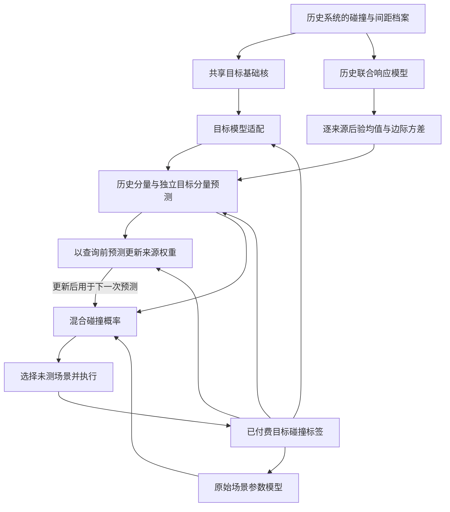

# 历史响应驱动的跨系统碰撞场景发现：问题定义与方法概述

自动驾驶系统的测试档案记录了不同交通条件下的成功避险与碰撞结果，为新系统的测试提供了可复用的经验。然而，相同的初始间距、相对速度和邻道交通条件，在不同驾驶系统上可能产生不同结果。历史系统中危险的场景可以为目标系统提供测试起点，目标系统自身的反馈则决定这些经验应当如何继续使用。本文据此提出历史响应驱动的跨系统碰撞场景发现方法，将多个历史系统的响应建模为可供目标反馈修正的概率先验，在给定执行预算内逐次选择测试场景。

## 交通场景与黑盒系统响应

考虑一类具有明确交互过程的功能场景，其参数空间记为 $\Omega$。场景 $\mathbf x\in\Omega$ 由连续参数与离散交通条件共同描述：连续参数包括车辆初始速度、车辆间距、事件开始时刻及持续时间，离散条件包括切入方向或邻道空间状态。连续参数按预先给定的物理上下界归一化，离散条件采用独热编码。下文以 $\mathbf x$ 表示编码后的场景输入，并在每类功能场景内分别构建响应模型。

被测自动驾驶系统记为 $a$。在固定的场景执行规则下，将场景 $\mathbf x$ 交由系统 $a$ 闭环运行，得到响应

$$
\mathcal E(a,\mathbf x)=\bigl(y_a(\mathbf x),d_a(\mathbf x)\bigr).
\tag{P1}
$$

其中，$y_a(\mathbf x)\in\{0,1\}$ 表示主车是否发生碰撞，由仿真的实际碰撞事件判定；$d_a(\mathbf x)\geq0$ 表示本次执行记录内，主车与其他交通参与者车身几何之间的最小距离。测试选择器可以设置场景输入并读取获准反馈，被测系统的控制参数、内部状态和决策梯度不参与场景选择。

两个响应量承担不同作用。碰撞标签定义需要发现的失效，最小间距描述尚未碰撞时的接近程度。例如，同样标记为未碰撞的两次切入执行，可能分别以较大间距通过和以很小间距避让结束。历史模型通过这类连续响应学习碰撞标签之外的场景差异，同时保留碰撞事件作为最终监督与评价依据。

## 历史知识与目标测试预算

设已经完成测试的历史系统共有 $S$ 个，其档案为

$$
\mathcal H=\{\mathcal H_s\}_{s=1}^{S},\qquad
\mathcal H_s=\{(\mathbf x_{s,i},y_{s,i},d_{s,i})\}_{i=1}^{n_s}.
\tag{P2}
$$

各档案保留系统来源，使模型能够分别表示不同系统的响应函数。共享模型参数在历史系统上学习，开发系统用于选择模型与确定设置；独立目标系统 $a_\star$ 的响应按实际测试顺序逐次开放。因而，跨系统迁移发生在同一功能场景内的响应函数之间。

目标测试在公开的有限候选集 $\mathcal X=\{\mathbf x^{(1)},\ldots,\mathbf x^{(N)}\}\subset\Omega$ 上进行。完成 $t$ 次查询后，方法使用的目标反馈为

$$
\mathcal D_t=\{(\mathbf x_i,y_i)\}_{i=1}^{t},\qquad
y_i=y_{a_\star}(\mathbf x_i).
\tag{P3}
$$

在线模型更新使用这些已查询的碰撞标签。历史最小间距用于构造先验，目标系统尚未执行的响应保持未知。设总预算为 $B$，初始化所需的 $b_0$ 次测试计入 $B$；随后每次从尚未执行的候选中选择一个场景，直至预算用完。

为衡量有效发现，令 $g(\mathbf x)$ 按预先确定的参数分辨率和离散交通条件，将场景映射到一个去重组。已发现的碰撞组集合为

$$
\mathcal F_t=\{g(\mathbf x_i):1\leq i\leq t,\ y_i=1\}.
\tag{P4}
$$

研究目标是在相同预算下获得更多碰撞组，并尽早形成这些发现，可概括为选择策略 $\pi$ 下的预算内效用

$$
J_B(\pi)=\mathbb E_{\pi}\bigl[|\mathcal F_B|\bigr],\qquad
\mathbf x_{t+1}=\pi(\mathcal X,\mathcal H,\mathcal D_t).
\tag{P5}
$$

本文以未测场景的预测碰撞概率作为单步选例准则，以去重碰撞数及其随预算增长的发现曲线评价策略。去重组反映参数组合的区分粒度；在线选择排除已经执行的候选，组级统计在评价阶段完成。在该有限候选集上，可进一步用已发现碰撞组占全库碰撞组的比例计算召回率。这里的碰撞概率用于表达模型对候选响应的预测，研究效用由有限库内的失效发现衡量。

## 方法的三个相互衔接的设计

方法以历史系统各自的碰撞与间距记录为输入，建立逐来源的碰撞响应后验。共享的联合响应核学习场景参数与两类响应之间的关系，各系统分别提供后验均值和边际方差。因此，历史经验既给出候选场景的危险程度，也保留该判断在历史观测下的不确定性，以及不同系统之间的响应差别。

目标系统产生反馈后，方法同时更新场景预测和来源可靠性。场景预测通过目标碰撞分类模型适配，再将已付费标签用于各历史来源条件模型的后验推断；来源可靠性则根据各分量在查询之前对本次结果的预测似然递推。前者改变目标反馈在场景空间中的影响，后者改变各历史来源对后续排序的相对贡献。另设使用原始场景参数的目标模型，使场景几何关系也能直接参与目标预测。

历史响应模型的训练围绕这一使用方式展开。训练时，将一个历史系统作为模拟目标，其余系统提供响应上下文；按测试顺序开放模拟目标的碰撞标签，按照部署时相同的目标适配、条件推断和可靠性更新规则预测留出的场景。由此，历史表示接受的监督直接来自“已有历史与少量目标反馈能否共同预测目标响应”，把离线知识构建与在线使用方式联系起来。

图中，历史档案为目标测试提供固定的响应先验，目标反馈驱动在线模型与权重更新。权重使用本次结果开放前保存的预测计算，更新后作用于下一次选择。完整流程始终围绕同一个决策对象：在剩余候选中，下一次执行哪个场景更有希望暴露目标系统的碰撞。

本文的方法贡献由上述设计的配合形成：以逐系统联合响应建立可迁移的危险区域线索，以目标反馈分别修正场景预测与历史来源的适用性，并通过模拟目标训练，使历史表示服务于实际的序贯预测过程。其数学构造与在线算法见[历史响应迁移章节](history_transfer/paper_section.md)，共用的核函数、分类推断和数值实现见[概率模型与推断章节](common/paper_section.md)。
